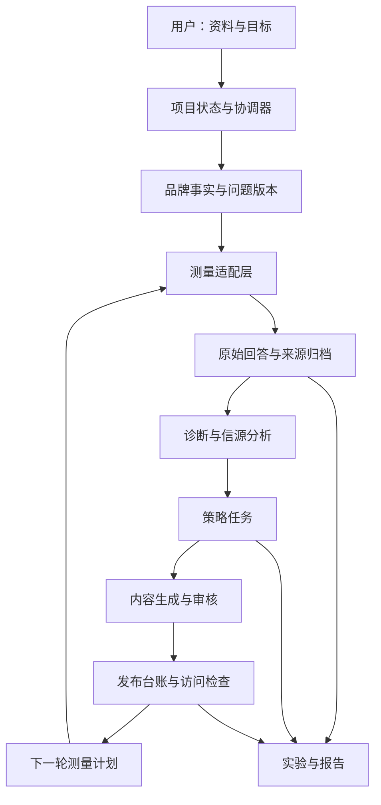

# CiteKeel 顶层设计

设计日期：2026-10-29。本文保留顶层设计；已有 0.1.0 本地原型，实际范围见 [当前实现](04-local-prototype.md)。

## 1. 产品判断

建议把个人开源 GEO Agent 定位为 **具备证据约束和实验能力的业务工作流**。

目标用户首先是自己和小型 GEO 项目负责人。一次项目的核心任务是：把“希望 AI 推荐我”变成已经确认的问题范围、准确的品牌材料、能够执行的改进任务，以及可以复查的观察记录。

产品首先解决三个实际问题：

1. 品牌资料不完整、含糊或相互冲突，直接生成内容容易扩大错误。
2. 监测结果与实际工作脱节，知道未被提及，却不知道应补哪项资产。
3. 更换问法、模型或统计分母后，前后数字看似改善，但无法解释变化。

成功标准是减少人工整理与核对工作，并保留判断依据。提及、推荐和引用的改善是待验证的实验结果，不预设为产品必然带来的收益。

独立开源的价值主张是：**流程可检查、能力可替换、示例可回放、实验可复验**。这是一项产品选择，尚无用户调研证明其市场差异足够形成商业优势。

## 2. 三类材料分别提供什么

| 材料 | 可以提炼的内容 | 使用口径 |
| --- | --- | --- |
| 克莱普斯公开官网与业务介绍 | 意图分析、数据整理、知识库、内容优化、场景适配、持续监测的服务链 | 官网是服务商对自身产品的描述；其算法、效果和资源规模没有在本次独立核验 |
| 实际客户资料整理经历 | 事实确认、问题分层、资产缺口、发布后访问检查、异常复测 | 抽象工作方法；公开示例重新创作 |
| 森博交流记录与已有个人方案 | 热词挖掘、内容生产、信源分析、数据监控、复盘组成 SOP；客户筛选候选问题 | 属于业务流程线索；据此提出的技术结构是本项目设计 |
| niubigeo 公开代码 | 连接模型、保存原文、测量、引用来源、历史比较与调度 | 作为明确署名的代码基础；源码优先于过时文档 |

克莱普斯官网的六步流程可作为业务参照，不能据此推断模型内部权重或保证推荐结果。[官网来源](https://www.klepsy.com/)

这次没有获取大创项目的私有源代码，也没有形成既有代码的可开源性清单。因此当前推荐的是依据经验重新建设可公开版本，不把商业系统视为已经能够直接迁出的代码资产。

## 3. 从具体业务切入

首个行业模板选 B2B 供应商选型，覆盖五类问题：

| 意图 | 示例 | 主要观察 |
| --- | --- | --- |
| 品牌核验 | 某公司做什么，是否支持定制 | 是否识别、描述是否准确 |
| 供应商发现 | 工业设备监测传感器供应商怎么选 | 未提示品牌时的自然出现与推荐 |
| 产品匹配 | 高温车间适合什么传感器 | 参数、限制与场景是否对应 |
| 信任核验 | 如何核验供应商检测报告 | 证据是否可核对、是否编造资质 |
| 采购决策 | 打样到批量交付要确认哪些事项 | 是否讲清交付条件与边界 |

候选问题由模型辅助扩展，但必须标明来自客户原话、公开问题、站内数据或模型推测。没有搜索量数据时，称为“候选问题”，不称为已验证热词。

## 4. 六个业务模块、八个 Skill

| 业务模块 | Skill | 输入 | 输出 | 进入下一步的条件 |
| --- | --- | --- | --- | --- |
| 品牌事实 | `brand-grounding` | 文档、网页、访谈材料 | 带来源、时间、适用范围的事实项；冲突与缺失清单 | 对外使用的事实已有确认记录 |
| 问题空间 | `query-discovery` | 产品、客户、场景与事实 | 按意图分组的候选问题及来源 | 用户确认问题集版本，品牌词与非品牌词分组 |
| 现状诊断 | `visibility-audit` | 问题版本、采样协议、归档回答 | 提及、推荐、引用、错误与未知项 | 原文可追溯，采集和分析状态已分开 |
| 信源与策略 | `source-analysis` | 回答、引用来源、现有资产 | 可核对的信源分布、资产缺口 | 引用、搜索结果、正文链接已分开 |
| 信源与策略 | `strategy-planning` | 差距、事实、成本与约束 | 按优先级排序的任务、假设及验收方式 | 每项任务关联目标问题与诊断依据 |
| 内容与交付 | `content-engineering` | 已确认事实、问题与任务 | FAQ、产品说明或选型文章草稿；事实对应表 | 无未解决的重要事实冲突，完成审核 |
| 监测与复盘 | `monitoring-analysis` | 固定问题集、前后采样与发布记录 | 可比变化、异常、无法判断的原因 | 条件变化被标记，失败样本没有混成未提及 |
| 监测与复盘 | `experiment-retrospective` | 实验协议、全部结果和执行记录 | 结论、限制、下一轮任务 | 结论可以返回原始记录，不超出实验范围 |

发布登记和网页访问检查由确定性工具完成。它们是业务步骤，不需要额外建立一个会自由决策的 Agent。

## 5. Agent、Skill 和 Tool 的分工

**Agent 负责在允许的状态转换中选择下一步。** 例如发现产品参数相互冲突，就产生确认任务；发现核心问题缺少对应产品页，就提出资产补强任务。

**Skill 负责完成边界明确的语义任务。** 每个 Skill 应包含用途、输入输出约束、提示词版本、工具权限、证据要求和失败示例。它既能由协调器调用，也能独立用于人工工作流。

**Tool 负责执行可检查的操作。** 包括读取文档、调用模型、解析来源、计算指标、检查页面和导出文件。指标计算、状态变更和预算核对采用代码规则。

第一版使用一个协调器和八个可独立调用的 Skill。Skill 是能力模块，不要求分别运行八个聊天 Agent。运行时由显式状态机控制，保留人工判断入口。

每次 Skill 调用记录：输入版本、使用的事实与样本 ID、Skill 版本、模型配置、输出、费用和校验结果。生成报告和策略时只传入需要的材料，不把整份客户资料发送给所有步骤。

## 6. 架构

逻辑循环按周期执行，`cycle_id` 区分每轮。下一轮引用上一轮快照，新结果不会覆盖历史证据。

建议沿用 niubigeo 的 TypeScript / Node 技术栈；首版采用单进程、单写入者和本地文件。新增业务状态与归档使用独立数据目录。先维持轻量部署，再根据真实并发与数据量决定是否引入数据库。

这个选择的前提是早期使用者为单人或由一个项目负责人串行操作。若多个服务进程同时写数据，本方案的文件状态和费用控制会成为薄弱处，需要先建立事务存储，再开放多人协作。

## 7. 核心数据对象

| 对象 | 关键字段 | 作用 |
| --- | --- | --- |
| Project | 品牌、范围、负责人、阶段、公开级别 | 隔离不同项目 |
| Claim | 字段、值、单位、定义、时间、适用范围、来源、确认状态 | 区分产能与实际产量等容易混淆的事实 |
| QuerySetVersion | 问题文本、意图、来源、是否带品牌、确认记录、版本 | 固定优化对象和统计范围 |
| MeasurementProtocol | 模型、端点、入口、语言、地区、会话条件、搜索模式、提示词及参数版本 | 判断能否比较 |
| Sample / Attempt | 计划样本 ID、尝试 ID、采集状态、分析状态、原文、原始响应、时间、费用 | 保存失败和重试，避免只保留成功结果 |
| Judgment | 样本、判定类型、值、原文位置、规则版本、复核记录 | 将模型标签与文本证据关联 |
| Citation | URL、来源类型、原始响应路径、检查时间 | 区分引用证据和链接 |
| Action | 问题、差距、事实、假设、负责人、产物、验收、状态 | 把诊断转成实际工作 |
| Publication | 内容版本、渠道、URL、发布时间、访问检查 | 区分完成草稿、审核、发布与可访问 |
| Experiment | 假设、对照、固定条件、样本范围、终止条件、结果与限制 | 让优化有检验方法 |

其中 Sample 与 Attempt 是一对多关系。自动重试不新增独立统计样本；主报告使用预先规定的首次尝试口径，重试恢复结果另列，避免成功重试造成样本选择偏差。

## 8. 四处人工确认

1. **事实确认：**阻止未经核对的数字、资质和客户关系进入对外稿件。
2. **问题确认：**锁定本轮测量的问题范围，修改后建立新版本。
3. **实验与指标确认：**先说明观察什么、分母是什么、哪些条件必须一致。
4. **内容审核与发布：**Agent 输出草稿和发布建议；第一版由人审核、发布，再登记结果。

已经确认的版本可重复运行，不要求每次读取、回放或计算都重新确认。

## 9. 五个工作页面

| 页面 | 首要回答的问题 |
| --- | --- |
| 项目概览 | 当前卡在哪里，下一步谁处理 |
| 品牌事实与问题集 | 哪些内容可信，本轮测量什么 |
| 回答与信源证据 | 模型实际说了什么，引用从哪里来 |
| 执行台账 | 应补什么，依据是什么，是否已经上线 |
| 实验与复盘 | 哪些观察发生变化，能得出什么结论 |

聊天框作为创建任务和解释证据的辅助入口。关键事实、版本、任务和报告保留结构化界面，便于检查与修改。

## 10. 名字与对外表述

| 候选 | 适合的方向 | 判断 |
| --- | --- | --- |
| **CiteKeel · 引舟** | 独立开源品牌 | 首选。引用与基础结构的含义贴合产品，建议仓库名 `citekeel` |
| QianzhuGEO · 千逐 GEO | 个人品牌项目 | 直观说明作者与领域，适合先以个人实验项目积累案例 |
| GEO 实验台 | 工具与教学定位 | 中文容易理解，品牌辨识度较弱 |

英文描述建议：**An open-source GEO workflow agent for traceable actions and reproducible experiments.**

中文描述建议：**从品牌事实到答案观察，让每次 GEO 优化有据可循。**

初步网页检索已发现 CiteTrail、CiteVine、CiteWeave、AnswerWeave 等相近领域名字被使用，因此没有采用。CiteKeel 是本方案的工作名，尚未注册仓库或域名。
