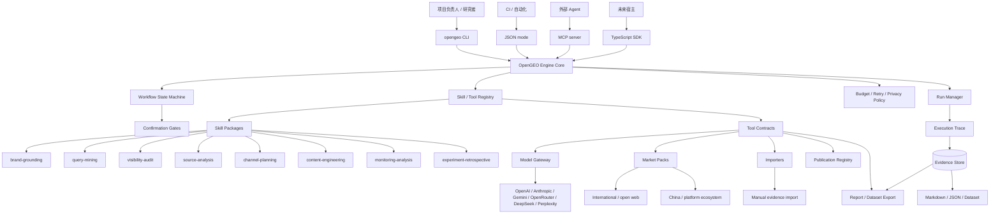
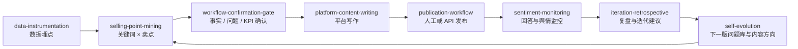
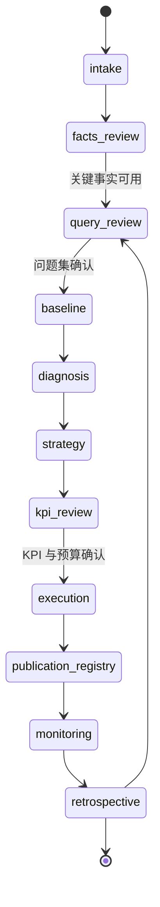

# OpenGEO Engine 顶层设计

> 2026-10-31 产品决策更新：默认采用 Topify 的 Web Agent 驱动全链路，自动从官网研究品牌、发现竞品与问题，再进入采集、诊断、行动和复测。CLI / MCP 保留为共享引擎入口。本文“网页仅作调试”和先手工准备全部事实 / 问题的旧定位由 [最新链路设计](08-topify-aligned-diagnostic-flow.md) 覆盖；下面保留历史架构背景。

设计日期：2026-10-29。本文是下一阶段方向：把当前 CiteKeel 原型中的证据链、Skill 约定和回放能力抽成一个 **CLI 优先的通用 GEO 引擎**。现有本地网页只作为调试宿主和实验记录，不再作为默认产品形态。

业务链路依据见：[关键链路和层级](../../resume/02-面试案例/Cenbo森博营科/关键链路和层级.md)。Pi 参考仓库：<https://github.com/earendil-works/pi>，MIT License；本次读取 `main` 分支提交 `19ce8059c3322f4172f24f0e25aa40bf0bdac62e`。

## 1. 定位

> OpenGEO 是一个以证据为中心的 GEO 交付与实验引擎。它把品牌事实、问题版本、平台回答、引用来源、执行任务和复盘结论保存在本地工作区，通过 Skill 和 Adapter 处理语义与平台差异，通过 CLI / JSON / MCP 被人或其他 Agent 调用。

中文表述：

> 从品牌事实到答案观察，让每次 GEO 优化有据可循。

它解决的不是“生成一批文章”，而是三个交付问题：

1. 客户资料含糊或冲突时，系统知道什么能说、什么必须确认。
2. 平台回答变化时，系统能追溯到原始回答、采样条件和引用 URL。
3. 做了内容或渠道动作后，系统能区分相关变化、自然波动和无法判断的情况。

## 2. 产品形态：不做默认网页

Pi 的启发是“最小可扩展 harness”：交互、自动化、RPC 和 SDK 都是宿主，核心能力不被锁死在某个界面里。OpenGEO 采用同样原则。

| 接口 | v0.1 目标 | 说明 |
| --- | --- | --- |
| CLI | 必须可用 | `init / import / diagnose / plan / report / replay` |
| JSON mode | 必须可用 | 输出 JSONL 事件，供 CI 和脚本调用 |
| MCP Server | v0.2 | 让 Codex、Claude、Pi 等 Agent 调用 GEO 能力 |
| SDK | v0.2 | TypeScript 嵌入式引擎接口 |
| TUI | 可选 | 项目状态与证据浏览，不承载核心逻辑 |
| Web | 可选宿主 | 仅作为本地调试或后续社区面板，不属于 v0.1 |

这样做的直接收益：

- 开发者可以在终端复现实验。
- 研究者可以把报告和数据集放进版本库。
- 其他 Agent 可以把 OpenGEO 当成工具，而不是迁移工作流。
- 业务人员最终仍可获得 Markdown 报告与确认清单。

## 3. 总体架构



## 4. 五层职责

| 层 | 负责 | 不负责 |
| --- | --- | --- |
| 业务交付层 | 项目、范围、客户确认、KPI、结项 | 自动替客户决定事实和验收口径 |
| 语义能力层 | Skill 的提示词、规则、输入输出约束和失败样例 | 无约束地自由聊天 |
| 工作流编排层 | 状态转换、确认门、重试、预算、失败路径 | 把关键流程交给模型即兴决定 |
| 数据与证据层 | 原文、版本、引用、任务、发布、实验、复现 | 只保存美化后的结论 |
| 运行与适配层 | CLI / JSON / MCP / SDK、模型、市场、导入、导出 | 默认提供在线多租户系统 |

## 5. 自进化交付循环

用户要跑的不是一个单次诊断，而是一条可以持续迭代自己项目的循环：



这 7 个 Skill 加 1 个确认门已经由 `npm run opengeo -- demo` 执行。当前实现是确定性规则版本，便于 CI 回放；后续模型只替换其中语义步骤，不能改变确认门和证据约束。

| 步骤 | 输入 | 输出 | 关键约束 |
| --- | --- | --- | --- |
| `data-instrumentation` | 项目、资产、指标 | 事件契约 | 采集与判定分离，失败样本保留 |
| `selling-point-mining` | 已确认问题、文章资产 | 关键词 × 卖点矩阵 | 每条卖点必须有资产证据 |
| `workflow-confirmation-gate` | 事实、问题、KPI | 通过或阻塞 | 候选不能自动变基线 |
| `platform-content-writing` | 确认事实、卖点 | 平台内容草稿 | 缺事实或证据时阻塞 |
| `publication-workflow` | 已审核草稿 | 发布任务 | 发布、可访问、被引用分状态 |
| `sentiment-monitoring` | 周期回答 | 提及、情绪、风险、引用 | 条件变化不混算 |
| `iteration-retrospective` | 证据与指标 | 迭代动作 | 每条动作绑定证据 |
| `self-evolution` | 复盘结果 | 下一版提案 | 候选问题等待人工确认 |

## 6. 建议仓库结构

```text
opengeo/
  packages/
    core/                 # 状态机、运行器、类型契约、确认门
    evidence/             # Evidence Store、导入导出、脱敏
    model-gateway/        # Provider 适配、费用、重试、响应归档
    skills/               # Skill 解析、注册、版本与调用协议
    adapters/             # 网页、国内平台、国际平台、发布登记
    cli/                  # opengeo 命令
    mcp/                  # MCP server
  skills/
    opengeo/
      data-instrumentation/
      selling-point-mining/
      platform-content-writing/
      publication-workflow/
      sentiment-monitoring/
      iteration-retrospective/
      self-evolution/
    brand-grounding/
    query-mining/
    visibility-audit/
    source-analysis/
    channel-planning/
    content-engineering/
    monitoring-analysis/
    experiment-retrospective/
  market-packs/
    intl-open-web/
    china-platforms/
  examples/
    opengeo/personal-ip/
    synthetic-b2b/
    posthog-archive/
    manual-import/
  docs/
  templates/
    project.yaml
    queries.yaml
    samples.jsonl
    report.md
```

第一阶段可以继续在当前仓库内渐进重构，不必立刻新建仓库；等 CLI 里程碑跑通后，再拆出 `opengeo` 独立仓库。当前 `vendor/niubigeo` 保留为 Provider 和采样适配参考，不把上游整体绑定成引擎内核。

## 7. CLI 工作流

### 7.1 初始化

```bash
opengeo init ./cases/demo
cd ./cases/demo
```

生成：

- `project.json`：品牌、行业、市场、目标，以及事实 / 问题 / 资产 / 观察 / 渠道假设的当前快照。
- `evidence/`：`imports.jsonl` 与 `facts|queries|observations|assets|hypotheses.jsonl`，追加写入、不覆盖。
- `runs/`：`<run-id>.json` 运行快照，以及 `index.jsonl` 运行索引。
- `reports/`：每次运行的 Markdown 与白名单 JSON。

`project.json` 是物化视图，`evidence/*.jsonl` 是导入审计日志，两者由 `import` 同时更新。当前实现用 JSON，而不是早期草稿里的 YAML。

### 7.2 导入与诊断

```bash
opengeo import ./cases/demo ./facts.json --type facts
opengeo import ./cases/demo ./answers.jsonl --type observations
opengeo diagnose ./cases/demo
```

`--type` 支持 `facts | queries | observations | assets | hypotheses`，按 `id` upsert；新增 `queries` id 会把问题库版本 +1。诊断输出：

- 有效样本、采集失败、解析失败、复核中。
- 品牌提及、推荐、指定资产引用。
- Provider 引用、搜索结果、grounding、正文链接的分布。
- 事实缺口和问题集缺口。

### 7.3 规划与报告

```bash
opengeo plan ./cases/demo
opengeo evolve ./cases/demo
opengeo confirm ./cases/demo <candidate-query-id> --status confirmed --priority P1
opengeo report ./cases/demo --run <run-id> --format md
opengeo replay ./cases/demo --run <run-id>
```

策略任务必须绑定：

- 目标问题 ID。
- 证据 ID。
- 事实 ID。
- 建议渠道与假设 ID。
- 验收方式。
- 负责人和人工确认状态。

### 7.4 JSON 模式

```bash
opengeo diagnose --json > events.jsonl
```

事件类型建议：

| 事件 | 说明 |
| --- | --- |
| `run.started` | 运行 ID、输入版本、模式 |
| `skill.started` | Skill、版本、输入摘要 |
| `skill.completed` | 输出对象与证据 ID |
| `skill.failed` | 错误、回退策略 |
| `gate.waiting` | 等待人工确认 |
| `sample.collected` | 采样状态、费用、延迟 |
| `run.completed` | 报告路径和限制 |

当前仓库已经可用：

```bash
npm run opengeo -- skills
npm run opengeo -- demo
npm run opengeo -- init ./my-opengeo-project
npm run opengeo -- import ./my-opengeo-project ./answers.jsonl --type observations
npm run opengeo -- diagnose ./my-opengeo-project
npm run opengeo -- plan ./my-opengeo-project
npm run opengeo -- evolve ./my-opengeo-project
npm run opengeo -- confirm ./my-opengeo-project <candidate-query-id> --status confirmed --priority P1
npm run opengeo -- report ./my-opengeo-project
npm run opengeo -- replay ./my-opengeo-project
npm run opengeo -- run ./my-opengeo-project
```

`examples/opengeo/personal-ip/project.json` 是一个脱敏个人 IP / 社区示例，包含确认事实、未确认事实、现有资产、两轮 AI 回答观察和两个渠道假设。运行后会生成报告、公开 JSON 和下一版问题库提案。

## 8. Skill 合约

每个 Skill 是一个目录，包含 `SKILL.md`、可选脚本、参考材料和测试 fixture。frontmatter 采用 Agent Skills 兼容格式：

```markdown
---
name: query-mining
description: Generate intent-grouped GEO query candidates from confirmed brand facts. Use before baseline measurement.
version: 0.1.0
---
```

Skill 定义必须写清：

1. 使用时机。
2. 输入 schema。
3. 输出 schema。
4. 允许引用的证据类型。
5. 禁止新增的信息。
6. 失败与降级方式。
7. 人工复核点。
8. 最小回放 fixture。

### 8.1 语义基础 Skill

| Skill | 主要输出 | 硬约束 |
| --- | --- | --- |
| `brand-grounding` | Claim、冲突、缺失 | 无来源不确认；冲突不覆盖 |
| `query-mining` | QueryCandidate、QuerySetVersion | 不虚构搜索量 |
| `visibility-audit` | Sample、Judgment、MetricSnapshot | 失败与未提及分开 |
| `source-analysis` | CitationProfile、AssetGap | 引用类型不混算 |
| `channel-planning` | ChannelHypothesis、ChannelAction | 平台偏好必须带证据区间 |
| `content-engineering` | Draft、FactTrace | 只用已确认事实 |
| `monitoring-analysis` | Trend、Anomaly、Cohort | 协议变化必须显式标记 |
| `experiment-retrospective` | Finding、Limitation、NextAction | 无对照不写因果提升 |

### 8.2 自进化循环 Skill

循环 Skill 位于 `skills/opengeo/`，实现入口在 `src/opengeo/engine.ts`：

| Skill | 当前确定性能力 | 后续模型增强点 |
| --- | --- | --- |
| `data-instrumentation` | 生成回答、判定、发布、自有渠道事件契约 | 按渠道生成埋点字段和采集方案 |
| `selling-point-mining` | 用词元重合度做可回放的关键词 × 卖点匹配 | 语义意图匹配和卖点抽象 |
| `platform-content-writing` | 生成带事实边界的平台草稿 | 面向官网、公众号、小红书、社区等改写 |
| `publication-workflow` | 生成人工发布检查清单 | API Publisher 与渠道模板 |
| `sentiment-monitoring` | 提及、情绪、风险标签、引用统计 | 更细粒度舆情分类和事实纠错 |
| `iteration-retrospective` | 证据缺口转 P0/P1/P2 动作 | 解释变化原因并设计实验 |
| `self-evolution` | 生成下一版问题库与内容方向 | 基于长期数据提出更合理候选 |

### 8.3 Skill 调用记录

每次调用保存：

```yaml
skill: query-mining
skill_version: 0.1.0
run_id: run_20261029_001
input_refs:
  - claim:claim_capacity_v2
  - queryset:v1
model:
  provider: openrouter
  model: qwen/qwen3.5-flash-02-23
  search: false
output_ref: queryset/v2
validation:
  status: passed
  warnings: []
cost_usd: 0.0004
latency_ms: 1200
```

## 9. 市场适配：国内与国外

GEO 的平台差异不能写成固定规则。OpenGEO 用 Market Pack 表达差异，用实验验证假设。

### 9.1 International / open-web pack

能力：

- 官网与文档抓取。
- robots、sitemap、llms.txt 检查与归档。
- 结构化数据、FAQ、产品页、公开报道的证据抽取。
- 搜索型模型 API 采样。
- 引用 URL、域名、来源类型和原始响应保存。

重要边界：

- llms.txt 是导航线索，不保证被读取或引用。
- 搜索广告与自然回答引用必须分开。
- API 结果不直接等同消费级网页客户端结果。

### 9.2 China / platform-ecosystem pack

能力：

- 平台能力矩阵：豆包、千问、Kimi、微信生态、抖音、小红书、新闻媒体等。
- 三类采样：API、浏览器采集、人工导入。
- 渠道资产台账：官网、公众号、短视频、新闻稿、问答、行业媒体。
- 发布路径：API 自动化、媒介协作、人工执行。
- ChannelHypothesis：记录“某平台更偏好某渠道”的样本区间与证据。

重要边界：

- “豆包最喜欢抖音”“国内只看媒体”“海外只看官网”都不能硬编码为事实。
- 人工导入必须记录时间、入口、账号状态、问题版本、原始文本或截图。
- 未稳定开放的接口不应伪装成自动采集能力。

## 10. 数据契约

### 10.1 Evidence Store

第一版使用本地文件 + append-only JSONL，优点是可 diff、可备份、可进入 Git。等多用户并发成为真实需求后再迁移 SQLite。

| 对象 | 关键字段 |
| --- | --- |
| `Claim` | id、value、unit、time_scope、source、status、confirmed_by |
| `QuerySetVersion` | version、queries、intent、branded、confirmed_at |
| `MeasurementProtocol` | model、entry、market、language、region、search、temperature |
| `Sample` | planned_id、query_id、protocol_id、status、answer、observed_at |
| `Attempt` | sample_id、error、raw_response、latency、cost |
| `Citation` | sample_id、url、type、response_path、checked_at |
| `Judgment` | sample_id、type、value、rule_version、reviewer |
| `Action` | query_id、evidence_ids、claim_ids、owner、status、acceptance |
| `Publication` | action_id、channel、url、publish_status、access_status |
| `Experiment` | hypothesis、control、fixed_conditions、result、limitations |
| `Run` | input snapshot、steps、traces、outputs、limitations |

### 10.2 状态机



状态转换必须写入 Run Trace。模型建议可以触发状态变更请求，不能绕过确认门。

## 11. MCP 设计

v0.2 暴露的工具：

| Tool | 功能 |
| --- | --- |
| `opengeo_diagnose` | 输入问题集和样本，输出诊断 |
| `opengeo_analyze_sources` | 分析引用和资产缺口 |
| `opengeo_plan_actions` | 生成绑定证据的策略任务 |
| `opengeo_generate_content` | 基于确认事实生成草稿 |
| `opengeo_import_evidence` | 导入回答、URL 或人工截图记录 |
| `opengeo_build_report` | 生成 Markdown / JSON 报告 |
| `opengeo_list_skills` | 列出可用 Skill 与说明 |

默认工具只读写显式传入的 workspace，不自动发布、不自动外发客户资料、不自动访问未声明平台。

## 12. 实验体系

| 实验 | 目的 | 关键条件 | 结论边界 |
| --- | --- | --- | --- |
| E1 回放 | 验证流程和证据链 | 固定输入、无模型或固定模型输出 | 不代表线上当前表现 |
| E2 基线观察 | 建立平台现状 | 固定问题版本、协议和市场 | 只描述观察，不归因优化 |
| E3 内容对照 | 检验资产改进 | 同问题、同协议、对照发布前后或对照组 | 未随机化时只给相关性证据 |
| E4 渠道假设 | 验证平台偏好 | 记录渠道、样本区间、失败率 | 不把个例推广为平台权重 |

开源示例必须标注来源：合成、公开归档、API 观察、人工导入，四者不能混称真实客户效果。

## 13. 从 CiteKeel 迁移

### 直接迁移

- `types.ts` 的核心对象思路。
- `analysis.ts` 的回答与引用分类。
- `engine.ts` 的分步执行、失败持久化、规则回退。
- `report.ts` 的 Markdown / JSON 导出。
- `cases.ts` 与 `examples/` 的回放案例。
- `skills/` 的八项能力约定。
- niubigeo 的 Provider 调用、费用与引用提取参考。

### 重构

- 把 `engine.ts` 拆成 Workflow Orchestrator 和 Run Manager。
- 把存储从当前项目状态改为 OpenGEO workspace。
- 把 Provider 调用抽到 Model Gateway。
- 把发布登记从内容状态中独立出来。
- 把 Web API 降级为可选宿主适配器。
- 增加 ChannelHypothesis 和 Market Pack。

### 不迁移

- 不把网页交互当核心依赖。
- 不承诺自动发布和平台排名。
- 不把当前规则判定描述为已校准的语义评估器。
- 不复用任何真实客户私有材料或原团队私有代码。

## 14. 里程碑

| 里程碑 | 内容 | 验收 |
| --- | --- | --- |
| M0 设计冻结 | 类型、workspace、Skill 合约、报告 schema | 文档与 fixture 可审查 |
| M1 CLI 回放 | 已实现：`opengeo demo / init / run / report / replay` 跑通自进化循环 | 无网络密钥可复现 |
| M2 导入与规划 | 已实现：`import`（5 类证据）、`diagnose`、`plan`、`evolve`、`confirm`；任务绑定证据 ID；workspace 追加日志 | 每个结论可回溯 |
| M3 MCP | 暴露核心工具 | 外部 Agent 能完成一次诊断和报告 |
| M4 Market Pack | 国际开放网页 + 国内平台假设包 | 至少各跑通一个脱敏案例 |

## 15. 命名与开源表述

工作名建议 **OpenGEO Engine**。`OpenGEO` 说明领域和开源属性，`Engine` 强调它不是又一个内容生成网页。npm 发布前需检查 `opengeo`、`@opengeo/core` 是否可用；若被占用，可用 `@qianzhu/opengeo` 或 `opengeo-engine`。

对外一句话：

```text
OpenGEO Engine: traceable GEO workflows, evidence, and reproducible experiments for AI answer visibility.
```

当前 CiteKeel 名称保留为 0.1.0 原型和研究记录，OpenGEO 是下一阶段引擎名。

