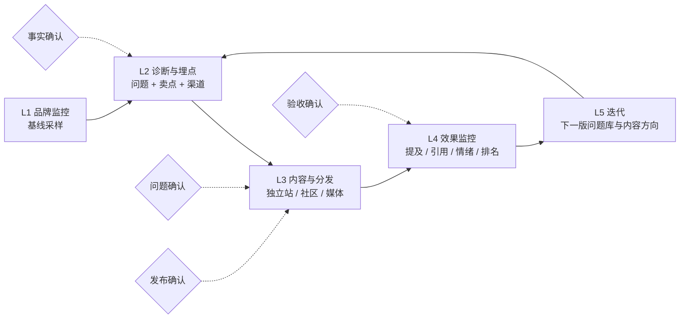

# GEO 五层认知（当前版本）

更新：2026-10-30 · 状态：**当前认知**，不是平台规则
用途：把「GEO 到底怎么做」收敛成一条可讲、可落地、可验证的业务链路。随调研持续修订。

## 0. 一句话

> GEO 是让品牌在 AI 回答里「被看见、被引用、被推荐」，并把这件事做成**可监控、可迭代**的交付循环。

它和 SEO 的区别不在「优化网页」，而在**优化对象变成了 AI 的答案**：排名变成引用，点击变成提及，页面权重变成「内容是否可被模型理解和信任」。

## 1. 五层总览

一句话版：**先看现状 → 再定打什么 → 再生产内容 → 再看有没有用 → 再改**。

## 2. 逐层拆解

### L1 品牌监控（基线采样）

**做什么**：打开各 AI 平台，用真实用户会问的问题，看品牌到底出不出现、怎么被描述、引用了谁。

**怎么做（当前观察）**：

- **真实浏览器**打开 ChatGPT / Perplexity / Google AI Overview / Gemini 等页面，模拟真实用户，抓取回答、引用、截图、时间、地区、语言。
- **Claude 走官方 API**：消费级网页端风控严，浏览器自动化容易封号。
- **国内平台**（豆包、DeepSeek、元宝、千问、Kimi 等）大概率同理，但平台更封闭、入口更分散，可能需要「浏览器 + 人工导入」混合。**这一点目前是假设，未验证。**

**输入**：品牌名、别名、官网、市场/语言/地区、一批初始问题。
**输出**：原始回答 + 引用 + 采样条件 + 失败记录（形成基线）。
**边界**：采样失败 ≠ 没被提及；API 结果 ≠ 消费级网页结果；一次采样 ≠ 稳定结论。

### L2 品牌诊断与埋点设计

**做什么**：基于品牌资料做诊断，然后回答三个问题——**客户会问什么、我们有什么可说的、重点埋在哪里**。

拆成三件事：

1. **诊断**：品牌现在被怎么描述？和竞品差在哪？哪些问题完全没有出现？
2. **需求点 / 问题挖掘（买点）**：模拟目标客户，产出「他会问 AI 的问题」候选；按意图分组（信息型、对比型、交易型、导航型）。
3. **卖点与埋点**：把品牌可核验的事实整理成卖点；决定**哪些内容、发在哪些渠道、对应哪些问题**（埋点 = 后续要监控的对象）。

**输入**：品牌资料、现有资产、竞品、历史问题。
**输出**：问题集版本（QuerySetVersion）、卖点矩阵（SellingPoint）、渠道假设（ChannelHypothesis）、埋点事件定义（EventDefinition）。
**边界**：没有搜索量数据时只能叫「候选问题」，不能叫「热词」；埋点不是「猜平台权重」，而是「记录要验证什么」。

### L3 内容生成与分发

**做什么**：针对 L2 选定的问题和卖点，批量生成内容并分发。

**海外做法（当前观察）**：

- 以**独立站 / 官网**为主：把产品页、FAQ、对比页、文档写清楚，让 AI 能抓、能懂、能引。
- 辅以 **Reddit、Twitter/X、行业媒体、LinkedIn、Medium** 等第三方内容，争取「被别人引用」。
- 工具侧会接 WordPress / Shopify / Framer 等 CMS 做一键发布（Topify 就是这样）。

**国内做法（假设，未验证）**：公众号、抖音、小红书、知乎、新闻稿、行业垂类媒体；平台封闭，发布路径可能是 API + 媒介 + 人工混合。

**输入**：已确认事实、卖点、目标问题、渠道。
**输出**：平台化草稿、发布任务、发布登记（发布 / 可访问 / 被引用分状态）。
**边界**：生成 ≠ 发布，发布 ≠ 被引用；不新增数字、资质、客户名、排名承诺。

### L4 效果监控

**做什么**：改动之后，用**同一套问题集和采样条件**再测一次，看有没有变化。

**监控什么**：

- 提及率、推荐率、引用率、事实准确性、情绪、排名位置、SOV（声量份额）、来源分布。
- 预设的 GEO 关键词 / prompt 集做周期埋点（每天 / 每周）。
- 基线 vs 对照：条件不同不能混算成「提升」。

**输出**：趋势、异常、可比/不可比标记、待复核项。
**边界**：检索到 ≠ 被引用（有研究显示只有约 15% 被检索页面进入回答）；被引用 ≠ 被正确引用（CJR 测试里 60%+ 回答有错）；没有对照就不能说因果。

### L5 迭代

**做什么**：把 L4 的结论变成下一轮动作——下一版问题库、下一批内容方向、渠道假设修正。

**输出**：迭代动作（绑定证据）、下一版问题库提案、内容方向、实验设计。
**边界**：候选问题仍需人工确认；不把自然波动包装成优化效果；不把一次观察写成平台规律。

## 3. 两个「五层」别混淆

我们材料里有两个「五层」，指的是不同东西：

| | 业务五层（本文） | 架构五层（[关键链路和层级](../../resume/02-面试案例/Cenbo森博营科/关键链路和层级.md)） |
| --- | --- | --- |
| 回答什么 | GEO 交付**怎么做** | 系统**怎么搭** |
| 内容 | 监控 → 诊断埋点 → 内容 → 监控 → 迭代 | 业务交付层 / 语义能力层 / 工作流编排层 / 数据与证据层 / 运行与适配层 |
| 用途 | 讲业务、拆 Skill、定 SOP | 拆模块、定接口、写代码 |

对应关系：业务五层里的每一步，落到架构五层里都要经过「语义能力（Skill）+ 工作流编排（状态机 / 确认门）+ 数据与证据（版本化）+ 运行适配（CLI / 模型 / 平台）」。

## 4. 三方对照

| 你的五层 | Topify（商业 SaaS） | Klepsy（国内服务商） | 森博（面试方） | OpenGEO（我们） |
| --- | --- | --- | --- | --- |
| L1 品牌监控 | 每日浏览器采样 4 平台 + Claude API | 平台矩阵实时搜索（豆包/DeepSeek/元宝/千问/Kimi 等） | 品牌监测、数据监控 | `visibility-audit` + 采样协议 + 原始证据 |
| L2 诊断与埋点 | bootstrap 生成 prompt（4 意图）+ 竞品自动检测 | 分析需求 → 梳理数据 → 搭建知识库 | 热词挖掘、初始诊断、优化难度、KPI | `brand-grounding` + `query-mining` + `selling-point-mining` + `data-instrumentation` |
| L3 内容与分发 | 文章生成 + Reddit 回复 + CMS 发布 | 优化升级 → 多场景适配 | 内容生产、渠道分发 | `platform-content-writing` + `publication-workflow` |
| L4 效果监控 | 每日采样 + visibility/sentiment/position/SOV/sources | 数据看板、持续优化 | 数据监控 | `sentiment-monitoring` + `monitoring-analysis` |
| L5 迭代 | agent 持续推荐 action、checkpoint 审批 | 持续优化 | 复盘、下一轮策略 | `iteration-retrospective` + `self-evolution` |

共同点：**五层本质是「测 → 定 → 做 → 测 → 改」**，差别在采样方式（浏览器 / API / 人工）、自动化程度、是否开放证据。

## 5. 术语消歧

| 词 | 建议用法 | 不要混用成 |
| --- | --- | --- |
| **埋点** | 记录要监控的事件、字段、时间与条件（instrumentation） | 「埋关键词」这种模糊说法 |
| **卖点** | 品牌可核验、可对外说的能力/事实（selling point） | 未确认的宣传语 |
| **买点** | 客户的购买触发点 / 他为什么会问这个问题（buying trigger） | 和「卖点」混为一谈 |
| **可见性** | 品牌是否出现在回答里（mention） | 曝光量、点击量 |
| **引用** | 回答里给出的来源链接（citation） | 品牌被提及 |
| **吸收** | 回答采纳了来源的内容（citation absorption） | 仅仅被引用 |
| **诊断 / 基线** | 改动前的现状测量 | 优化后的效果 |

## 6. 对 OpenGEO 的映射

业务五层 → 我们的 Skill：

| 业务层 | 语义 Skill（8 个） | 循环 Skill（7 个） |
| --- | --- | --- |
| L1 监控 | `visibility-audit`、`source-analysis` | `data-instrumentation` |
| L2 诊断埋点 | `brand-grounding`、`query-mining`、`channel-planning` | `selling-point-mining`、`workflow-confirmation-gate` |
| L3 内容分发 | `content-engineering` | `platform-content-writing`、`publication-workflow` |
| L4 监控 | `monitoring-analysis` | `sentiment-monitoring` |
| L5 迭代 | `experiment-retrospective` | `iteration-retrospective`、`self-evolution` |

当前实现状态：CLI 的 `demo / init / import / diagnose / plan / report / replay` 已跑通确定性版本；模型步骤（M3 Model Gateway）与真实 UI 采样（M5 Market Pack）还没接。

## 7. 认知边界

**事实（有公开来源）**

- Topify 用真实浏览器采样 4 个平台、Claude 走 API；每日跑；原始回答永久保留。
- CJR 测试 8 个 AI 搜索工具：60%+ 回答有引用错误；检索到 ≠ 被引用。
- KDD 2024 GEO 论文：加引用/引文/统计能提升可见性，关键词堆砌反而更差。

**假设（未验证）**

- 国内平台「大概率同理」的采样方式。
- 国内内容分发以公众号/抖音/小红书/新闻稿为主。
- 「五层」是行业普遍形态（目前只在 Topify、Klepsy、森博三处观察到相似结构）。

**未知**

- 国内各平台的实际引用权重与采样可行性。
- 各家「效果提升」数字的可复现性。
- 浏览器采样在长期、跨地区的稳定性与合规边界。

## 8. 下一步验证清单

1. 用我们自己的 workspace 跑一遍 L1→L5，确认每层都有可回放证据。
2. 给 L1 补一个真实浏览器采样适配器的设计（失败、地区、语言、时间戳）。
3. 给 L4 设计一个「基线 vs 对照」的最小实验（固定问题集、固定协议）。
4. 用 1–2 个真实行业样本，验证 L2 的问题挖掘与卖点矩阵是否可用。

## 9. 延伸

- [2026-10-30 面试交流纪要：GEO 的平台化与岗位分工](./research/2026-10-30-访谈笔记.md)
