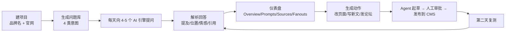

# Topify 到底怎么运作：完整用户体验、GEO 优化、检测与定时采集

日期：2026-11-02。写给"看完逆向记录还是没懂这个产品在干嘛"的读者。
依据：登录态页面观察（11 个页面、31 个内部端点）、官方文档（`docs.topify.ai/llms-full.txt`）、REA 静态分析。每条事实后面标了来源类型：**UI**（页面看到）、**DOC**（官方文档自述）、**NET**（网络请求）、**INFER**（推断，未验证）。

## 0. 五句话版本

1. Topify 每天替你向 ChatGPT、Perplexity、Google AI Overview、Gemini（Claude 走 API）问一批"买家会问的问题"。
2. 它把每条回答拆成四件事：有没有提到你、第几个提到你、语气好不好、引用了哪些网页。
3. 它把这些数字做成趋势，告诉你哪些问题你没出现、哪些网页被 AI 信任、竞品在哪些问题里赢。
4. 它把差距变成"动作"：改你现有页面、写新文章、发 Reddit 回复，再用 Agent 写出来、你审批、发到你主站。
5. 第二天再问一遍同样的问题，看数字有没有变——这就是它说的 GEO 闭环。



## 1. 完整用户体验流程（第一次使用）

### 第 0 步：建 workspace（约 1 分钟）

输入品牌名和官网 URL，可选语言（如 en）与国家（如 US）。**UI**

### 第 1 步：后台 bootstrap（用户看不到，1–10 分钟）

系统异步做四件事：**DOC + UI**

1. 抓你的官网，理解你做什么、卖给谁；
2. 生成一批"种子问题"，覆盖四种意图：informational（是什么）、commercial（哪个好）、transactional（怎么买）、navigational（找品牌）；
3. 立刻把这批问题发给所有引擎跑第一轮，拿到真实回答；
4. 从回答里找出"经常和你一起出现"的品牌，作为候选竞品。

接口返回 `202 Accepted`，完成时通过 webhook 或前端轮询告知。此时页面会显示 `initializing`。

### 第 2 步：Review & Confirm（3–5 分钟）

用户确认三样东西：**UI**

- 品牌身份（名称、别名、域名）；
- 候选竞品（Track / Reject）；
- 建议问题（Active / Suggested）。

**没确认的竞品和问题不进入每日监测**；但 bootstrap 的首轮采样已经发生并计费（竞品检测依赖真实回答）。确认动作影响的是“以后每天测什么”，不是“这次花没花钱”。

### 第 3 步：进入 Agent（起始页）

Agent 是聊天入口，四组能力：**UI**

| 组 | 能做什么 |
| --- | --- |
| Research | 关键词研究、竞品分析、内容缺口 |
| Content | 内容策略、写文章、发布文章 |
| Analytics | 站点画像、SEO 分析、Search Console 表现 |
| Optimize & publish | GEO 改写、按行业套用 8 项技巧、发布到 CMS |

右下角显示 `GSC not connected`：没接 Google Search Console 时，Agent 只能给通用建议。

## 2. 日常主循环：用户每天看到的 6 个页面

### Overview（总览）

- 指标切换：Visibility / Sentiment / Position / SOV；
- 筛选：日期（7/14/30/90 天）、模型、品牌；
- 图表："Brand Charts / Brand Performance (Updated 16:00 UTC)"；
- 状态条："Nov 2 data is still processing — showing data through Nov 1"——**当天批次没跑完时，不假装有当天数据**。**UI**

### Prompts（问题库，最重要的一页）

三个视图：**UI**

| 视图 | 列 |
| --- | --- |
| Active | Topic、AI Volume、Visibility、Sentiment、Position、SOV、Mentions、Intent、CVR、Location |
| Suggested | Suggested Prompt、For URL、Overlap、AI Volume、Citing / Competing、Type、Actions、Suggested At |
| Heatmap | 按主题看覆盖密度 |

每行能点开看：该问题在各引擎的回答、时间、位置、情感、引用。**这是"检测"的最小证据单元。**

### Sources（AI 引用了谁）

- Domain / URL 两级切换；
- 列：Rank、Domain、Domain Type（corporate / editorial / institutional / reference / UGC）、Used、Avg Citations、Citation Share、Mentioned、Brands Appear；
- 用途：找出"AI 在这个品类里信任哪些网站"，以及你的域名有没有被引用。**UI + DOC**

### Fanouts（AI 把问题拆成了什么）

回答之前，AI 常常自己先搜几个子查询。Fanouts 页显示：**UI + NET**

| 列 | 含义 |
| --- | --- |
| Query | AI 实际发出的子查询 |
| Provider | 哪个引擎 |
| Occurrences | 出现次数 |
| Prompts | 被哪些主问题触发 |
| Brands | 这些子查询里出现了哪些品牌 |
| Last used | 最近一次 |

用途：发现"用户问题 → AI 实际搜什么"，这是写内容的选题矿。

### Competitors（竞品）

- 列：Rank、Brand、Visibility、Sentiment、Position、Actions；
- Suggested Competitors 带提及次数 + Track / Reject；
- 提示："Just added a competitor? Calculate its earlier visibility using responses already collected"——**回填历史，不用重新采样**。**UI**

### Recording（URL 资料池）

- 先加 URL（官网栏目、竞品页、行业文章）；
- 列：URL、Title、Added；
- 选中最多 5 个 → Generate Prompts，把"资料"变成"候选问题"；
- URL 本身不是回答，不计入引用。**UI + DOC**

### Actions（动作中心）

- 四类：On-page SEO、New Articles、Rewrite Articles、Reply on Reddit；
- 过滤：effort（Quick win / Moderate / Major）、Todo / History；
- 顶部显示 Credit Balance；
- 每条动作有目标、优先级、预计影响区间、依赖关系、执行方式。**UI + DOC**

### 管理区

Project（品牌 / 默认品牌排序 / 集成）、Members（角色、API Keys）、Subscription（credits、充值包）、Referrals（推荐返利）。**UI**

## 3. 它到底怎么"优化主站的 GEO"

先纠正一个误解：Topify **不直接改你的网站代码**，也不保证排名。它做的是三件事：

### (a) 让 AI 更容易"读懂并引用"现有页面

- `on_page_seo`：结构化数据、FAQ、清晰的事实与数字、页面层级建议；
- `content_update`：改写已有文章，套用 Princeton KDD 2024 的 8 项技巧——**引用来源、统计数字、专家引述、权威语气、易读语言、术语解释、词汇多样性、流畅度**；官方给的提升区间是 +15% 到 +40%，并注明"行业不同、实际不同"。**DOC**

### (b) 增加"可被引用"的新页面

- `new_content`：Agent 先给大纲，再写全文，再出终稿；**outline → draft → final 三次 checkpoint 人工审批**；
- 通过后发布到 WordPress / Shopify / Framer（REST / GraphQL / CMS API）；
- 发布回执 ≠ 被 AI 引用；要等下一轮采样才知道有没有效果。**DOC**

### (c) 增加第三方提及

- `forum_engagement`：找 Reddit 相关帖子，生成回复草稿；
- Sources 页看到的行业媒体、UGC 平台，就是"AI 信任的第三方"清单；
- 官方渠道建议：自有博客为主，行业媒体 / LinkedIn / Reddit / Medium 为辅。**DOC**

每条动作都带：

```text
目标（url / keyword / page_type / domain）
effort（quick-win / moderate / major）
expected_impact_min / max（百分点区间，不是承诺）
depends_on（动作依赖）
execution（prompt / publishable_content / forum_reply / manual）
```

## 4. "检测 GEO"到底检测什么、怎么判

### 检测单元

**一个问题 × 一个引擎 × 一天 = 一条回答（一条样本）。**

### 从回答里解析四件事

| 解析对象 | 做法 | 注意 |
| --- | --- | --- |
| 品牌提及 | 抽出回答里出现的品牌列表 `brands_mentioned`（去重） | 品牌名与别名都要匹配；名字撞词会误判 |
| 情感 | 对每个出现的品牌打 0–100 分，每条回答一个分 | 只在"提到了"的回答上算 |
| 位置 | 找每个品牌**第一次出现的字符位置**，排序，取你的名次 | 数字越小越靠前；没出现为 0 |
| 引用 | 回答里的 URL / 搜索来源 / grounding | domain 与 URL 两级 |

### 派生指标（可复算的部分）

```text
Visibility = 提到你的回答数 / 总回答数
SOV        = 你的品牌槽位 / 所有品牌槽位   （同一回答内每个品牌只算 1）
Position   = 你在每条回答里的名次，再对"提到你的回答"取平均
Sentiment  = 提到你的回答的情感分平均
Mentions   = 竞品在回答里出现的次数
Source Used% = 引用该来源的回答 / 总回答
Avg Citations = 引用总次数 / 引用过它的回答数
```

**不公开算法**：AI Volume（需求量估算）、CVR（内容可见率）——公开 API 有字段，但官方明说 volume 的公式 proprietary。**DOC**

### 为什么同一个品牌在不同工具里分数不一样

- 采集方式不同：网页 UI vs 官方 API，答案本身就不一样（Surfer 2026：品牌重合度只有 21.3%–31.6%）；
- 引擎不同、地区不同、账号不同、时间不同；
- 分母不同：失败样本算不算、重试算不算；
- 指标定义不同：情感是每条回答一个分，还是每次提及一个分。

Topify 自己的博客也承认"同一品牌同一问题，不同平台给 72 / 41 / 不给"。**DOC**

### 证据链长什么样

```text
Overview 数字
  → Prompts 行（某问题）
    → 原始回答（Provider、时间、协议）
      → 引用 URL / 搜索来源
        → Sources 反查该 URL 还被哪些回答引用
```

这条链是"可验证"与"黑盒打分"的分界线，也是 OpenGEO 要复用的核心。

## 5. 数据定时采集是怎么做的

### (a) 两条采集链

| 时机 | 做什么 | 计费 |
| --- | --- | --- |
| bootstrap（建项目时一次） | 生成问题 + 首轮全引擎采样 + 算指标 + 竞品检测 | 消耗 credits（示例：5 问题 × 3 引擎 ≈ 15 credits） |
| 每日 run | 所有 active 问题 × 所有引擎，各跑一次 | 每天消耗 credits |

**DOC + UI**（状态条、更新时间、credits 使用率）

### (b) 批次时间与状态

- 页面显示 "Updated 16:00 UTC"，说明批次在固定时间窗口完成；
- "Nov 2 data is still processing — showing data through Nov 1" 说明当天批次未完成时，界面显示上一日数据；
- 数据永久保留，7/14/30/90 天只是查询窗口，不是删除策略。**UI + DOC**

### (c) 怎么"问"这些引擎

- ChatGPT、Perplexity、Google AI Overview、Gemini：**驱动真实消费级网页**（自动化浏览器会话），因为官方 API 与网页答案不同；
- Claude：走官方 API（官方认为差异不大）。**DOC**

这意味着后端需要：账号/会话池、地区出口、反自动化处理、失败重试与配额控制。**INFER**（文档没写实现细节）

### (d) 我们实际看到的证据边界

- **看到**：前端轮询、批次状态、`initializing` 状态、credits 消耗、`/api/v2/actions/recommend` 这类异步推荐调用；
- **没看到**：服务端 cron / 队列实现、重试策略、失败样本是否进分母、并发与限流；
- **不能声称**："它就是每小时跑一次"或"失败会自动重试三次"——这些没有证据。

### (e) 如果你要自己实现（给 OpenGEO 的设计草图）

```text
cron（每天固定时刻）
  → 生成 run 记录（幂等键：projectId + 问题版本 + 引擎 + 日期）
  → 入队（每个 问题×引擎 一个 job）
  → worker 取 job：打开会话 → 提问 → 保存原文/引用/截图/耗时/费用
  → 失败：记录 attempt，按策略重试；超过上限标记 failed（不进分母）
  → 全部完成：跑判定 → 写指标快照 → 标记 run 完成
  → 前端只读快照，轮询 run 状态
```

关键设计：**run / attempt / observation 三层分开**，重试不算新样本；**快照与原文分离**，指标可重算；**幂等键防重复计费**。

## 6. 对照 OpenGEO：我们做到哪一步

| 能力 | Topify | OpenGEO 现状（2026-11-02） |
| --- | --- | --- |
| URL 建档 + 自动研究 | 有，异步 bootstrap | 有（URL-first，最多 3 页） |
| 问题库 | Active / Suggested / Heatmap + 10 列 | Active / Suggested，缺 Volume/SOV/CVR/Heatmap |
| Recording | URL 池 → 选 5 个 → 生成问题 | **已接通**（收集、失败态、生成 suggested） |
| Sources | Domain/URL、Used、Citation Share | 只有引用平铺，缺聚合 |
| Fanouts | 独立页 + 子查询洞察 | 有 `listObservedFanouts`，缺页面/接口 |
| Competitors | 实体 + suggested → Track/Reject | 缺实体 |
| Actions | 4 类 + 工作流 + 审批 + CMS | 规则任务 + 草稿，缺审批恢复与 CMS |
| 每日采集 | 全引擎、每日、永久保留 | 只有手动 API 基线 |
| 团队 / 计费 | 有 | 本地单用户 |

## 7. 一句话总结

**Topify 卖的不是"GEO 分数"，而是"每天替你问 AI、告诉你差在哪、帮你改、再问一遍"的闭环。** 分数只是这个闭环的仪表盘；真正难的是采样稳定性、口径一致、动作执行和复测纪律。

## 8. 证据边界

- **UI**：11 个登录后页面、列、按钮、状态条、空态；
- **NET**：31 个内部端点、9 份去值响应结构（字段名/类型，无值）；
- **DOC**：每日 run、永久保留、bootstrap、credits、Actions 状态机、8 项技巧、采集方式；
- **INFER**：调度实现、重试与分母、地区路由、并发；
- **UNKNOWN**：Volume/CVR 公式、失败样本处理、采样集群部署。

详见 [11 登录后产品复核](../references/competitors/topify/11-logged-in-reverse-2026-11-02.md) 与 [10 公开 API 与服务逻辑](../references/competitors/topify/10-public-api-and-service-logic.md)。
