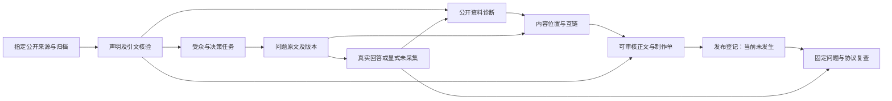

# 16 · 松灵案例与 Agent 交付架构

更新：2026-11-05。当前两天迭代的主案例为[松灵机器人](../案例/松灵机器人/00-案例说明.md)。本项目仍是本地、单用户、开源工作台；本轮是外部研究，未获公司后台、硬件或发布权限。

## 1. 这次要解决的问题

旧工作流有品牌、问题、诊断、策略和内容步骤，但受众和内容位置主要隐含在提示词里；内容通常是一份通用说明，报告又偏执行日志。结果难以判断一份稿件为谁解决什么问题，也难把它接到后续复查。

新增 Campaign（案例交付）层，把个人顾问实际需要的交付关系保存在明确合约里。现有 Project / AgentRun 与采集模块继续使用；不复制账号系统，也不为一个案例重写现有工作台。



语义分析由执行任务的 Agent 读原文后写入策划；运行器负责确定性验证和生成。`editorial-input` 表示策划输入，`deterministic` 表示规则执行。当前没有自动派生多个独立 Agent、没有额外模型调用，也没有自动发布或持续采样。不能只因设置了节点名称就声称实现了自主多 Agent 系统。

## 2. 代码与数据边界

| 层 | 实现 | 责任 |
| --- | --- | --- |
| 合约 | `code/src/citekeel/campaign/model.ts` | 来源、声明、受众、问题、内容、尝试、协议、发布记录和执行结果 |
| 证据 | `campaign/evidence.ts` | 复用现有 DNS 固定公共抓取器；指定 URL 串行读取、正文提取、不可变快照、哈希与本地路径校验 |
| 运行与比较 | `campaign/run.ts` | 引文核验、引用映射、失败排除、同任务去重、逐题逐平台逐协议统计、两轮可比性 |
| 采样导入 | `campaign/import-attempt.ts` | 校验案例内四件套、Xue 身份、问题原文、metadata 协议和可见链接；规范化回答并追加真实尝试 |
| 交付 | `campaign/render.ts` | 执行摘要、品牌诊断、受众问题、布局、正文、内容报告、基线、回答明细、附录和工作台适配 |
| CLI | `code/scripts/campaign.ts` | collect / run / install / compare |
| 回归验证 | `code/test/campaign.test.ts` | 用离线 fixture 验证证据、状态、计数和比较，不用合成数据证明真实效果 |

`01-案例策划.json` 是可审查的 Agent 分析输入，不能声称由脚本自动研究得出。`02-来源归档.json` 保存真实读取方法、覆盖范围、失败和 SHA-256。`03-采样记录.json` 只接受实际尝试；目前为空。

正文和工作台项目由同一输入生成。映射到旧 Project 时，公开声明仍为 `unconfirmed`，不会因引文匹配就绕过产品事实确认。生成独立研究稿可以采用“来源如何陈述”的写法，但不会将其标成公司已审核或独立实测的产品内容。

## 3. 节点交接与输出

| 节点 | 核心输入 | 交接产物 | 当前边界 |
| --- | --- | --- | --- |
| 来源与声明 | 指定 URL、保存正文 | 带来源、型号范围与精确短引文的声明 | 引文存在不等于产品实测；片段不当全页 |
| 受众 | 产品与解决方案材料 | 决策任务、关切、受众依据、验证方式 | 官网目标受众与真实客户痛点分开 |
| 问题 | 受众、目标、资料 | 阶段、语言、是否点名、原文与版本 | 候选不冒充真实搜索需求 |
| 回答诊断 | 真实尝试、原件与协议 | 出现与原句、有效分母、失败原因 | 没有 Xue 连接就未采集，不能用用户1替代 |
| 布局 | 用户问题、现有材料与诊断 | 页面／稿件、位置、互链、制作单 | 建议位置未发布，不保证索引或引用 |
| 内容 | 制作单与已核对来源 | 英文或中文独立正文、来源链接与审核缺项 | 不执行机器人，不生成虚构成功案例 |
| 复查 | 原问题、协议、发布记录 | 当前基线、第一批 12 条任务、观察差值 | 后台数据未知；没有因果效果证明 |

对应 Skill 入口为 [`opengeo`](../code/skills/opengeo/SKILL.md)，新增 [`audience-research`](../code/skills/audience-research/SKILL.md) 和 [`content-layout`](../code/skills/content-layout/SKILL.md)，内容／问题／监控技能同步补充合约。

## 4. 如何复跑

全部命令在 `code/`：

```bash
npm run campaign -- run "../案例/松灵机器人/第1轮"
npm run campaign -- install "../案例/松灵机器人/第1轮"
npm run campaign -- compare "<前轮目录>" "<后轮目录>"
npm run campaign -- import-attempt "../案例/松灵机器人/第1轮" --id <新采样ID> --job <同任务ID> --question Q01 --platform chatgpt --evidence evidence/incoming/Q01-chatgpt
```

- `run`：只读归档并重算；覆盖派生报告，保留来源与采样输入；没有新网络或模型调用。
- `install`：重算后导入现有本地工作台。相同项目 ID 已存在时拒绝覆盖人工确认、历史样本与设置。
- `collect`：新轮次按明确 URL 采集公开资料，复用 DNS 固定抓取，不携带登录态。已有来源归档时拒绝覆盖；官网读取失败时保留失败，不绕过验证。
- `compare`：只比较同案例的递增轮次。品牌／别名口径、问题全文与版本、平台和完整协议必须一致；未知条件不计算差值。命令在后轮生成 `13-两轮比较.md`，先说明可比组合，再展示观察差值；可比差值仍不是因果或运营提升。
- `import-attempt`：不联网、不提交问题、不替代 Xue 采集。采集器先把四件套放在案例内临时目录，导入器核对 metadata 与协议、剥离问题原文造成的假品牌命中，并把完整或失败尝试追加到 `03-采样记录.json`；同一 jobId 的重试不新增分母。

搜索读取工具能取得正文片段、而 HTTP 失败时，可以保存工具返回的原文片段，但须记录 `native-web-excerpt` 和 `excerpt`，保留原 HTTP 失败尝试。本轮 5 项官网来源属于这一情况；官方 GitHub 的 3 项为 HTTP 文本。

## 5. 松灵首轮已得到什么

8 个公开来源、16 项有原文定位的来源陈述、3 组受众、12 个中英文候选问题、4 个内容交付：未点名科研选型指南、PiPER 集成 FAQ、教育选型指南、LIMO PRO 参数标签核验提案。

当前诊断只评价公开材料和内容机会，不评价六平台品牌表现。LIMO PRO 读取文本的 Payload／weight 标签疑点是待核验项，不能把提取文本直接升级为已确认的网站缺陷。产品已有 FAQ 与技术入口，内容建议不能写成“官网没有 FAQ／没有文档”。

当前 `AI 基线=未采集`、`发布=未记录`、`效果=未知`。有稿、有布局和测试通过，均不等于 GEO 成效已经验证。

## 6. 两天迭代顺序与验收

按当前授权持续推进；这里是工作顺序，不是已经运行的后台定时任务。

| 阶段 | 验收 | 当前状态 |
| --- | --- | --- |
| 交付架构 | 一个受众问题可回到材料、制作单、正文和复查任务；原件不变；可离线复跑 | 已实现，待持续语义审阅 |
| 松灵内容 | 读者能看懂诊断，稿件有来源、适用边界及审核缺项 | 已有首轮独立稿，未获公司审核 |
| 工作台联通 | 通过既有 Project 适配展示资料与候选，不覆盖已有项目 | 已实现 CLI；不新增平行 UI |
| 真实基线 | 核对 Xue 后，先执行 12 条第一批计划：国际平台英文未点名／点名各一，国内平台中文未点名／点名各一；原件完整，失败单列 | Xue 用户与目录已核对；扩展连接授权待用户确认，未使用用户1采样 |
| 回答诊断迭代 | 依据真实原句补品牌印象、竞品叙事、引用和参数风险 | 待真实基线，不用推测填充 |
| 后续复查 | 相同协议与问题版本比较；无发布则只称观察变化 | 比较器已实现，真实后测未完成 |
| 真实运营效果 | 发布回执与公司授权的后台、咨询数据 | 当前不具备权限，不作为外部试点虚构目标 |

完整实现不要求未来上线企业后台、席位、计费或云端浏览器农场。下一步优先级是可信样本和读者可用的内容，不是多铺页面。
