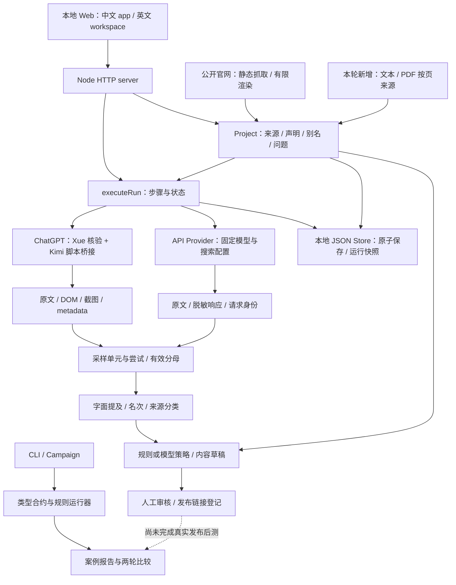

# 架构、报告质量与松灵面试评估

状态：active。最后复核：2026-11-08。

## 判断

**INFER：这个项目足以作为松灵 GEO 实习面试的主项目，但附件报告不足以作为正式诊断交付，更不能证明增长效果。** 岗位要求从 0.5 到 1 探索路径、分析数据、尝试工具、沉淀工作流，当前项目有可核对的相关证据。录用结果、内部岗位标准、其他候选人表现未知，不给虚假成功概率。

面试最好展示「干净的小样本 + 一条可信发现 + 一份有来源的中英文内容 + 一套复测设计」，而不是先展示漂亮的总百分比。数据有效性事故本身能成为强故事，前提是说清如何发现、隔离、修复和避免复发。

## 实际架构

JS（源码事实）：

| 层 | 已有能力 | 当前缺口或代价 |
| --- | --- | --- |
| Web 与服务 | `server.ts`，两套原生 JS 页面；本地 Host / Origin 校验 | 两套视图重复，新增能力需保持一致；服务路由、配置、调度较集中 |
| 品牌建档 | `onboarding.ts`、`research-service.ts`，官网抽取、声明确认 | 过去缺少项目建立后补资料到事实的完整链路；材料不等于核实事实 |
| 问题与实验 | `prompts.ts`、`question-set.ts`，版本、状态、标题剔除 | `branded` 布尔值不足以表达自然发现、候选比较、品牌事实和信任证据 |
| 采样 | `engine.ts` 的 measurement 单元与 attempts；UI / API 分开记录；失败保留 | 自动化正式网页适配器当前只有 ChatGPT；案例中其他网页历史回答不证明这些适配器可用 |
| 留存 | `storage.ts`：本地 JSON，临时写入后 rename、项目更新队列、运行快照 | 个人小样本足够；尚非全局不可变事件存储，未保证跨进程数据库事务；暂不为规模换架构 |
| 指标 | `analysis.ts`、`brand-metrics.ts`、`geo-rates.ts` | 工作台首次出现顺序与 Campaign 枚举推荐顺序不统一，不应统称一个 Top3 |
| 策略与内容 | `skills.ts`、`international.ts`；规则回退、模型输出 ID 校验、事实确认门禁 | 有 ID 只证明引用存在，不证明语义支持；模型策略摘要截到前 1200 字，可能丢失关键上下文；正文仍偏通用 |
| 案例交付 | `campaign/*`：来源快照、引文核验、正文、采样导入、可比性检查 | editorial-input 的高质量人工策划没有自动进入所有工作台生成路径；不应把案例稿质量当自动生成能力 |
| 复测 | Campaign 比较器、发布链接登记 | 发布登记没有验证访问或索引；定期调度、真实发布回执、同协议后测未完成 |

本地单体架构适合现阶段。最先补的是数据与决策合约，不是微服务、多 Agent 或云端多租户。UI 中的 Skill / Step 代表执行节点，不证明有多个独立 Agent。

## 对附件报告的审计

DOC：附件运行 `20952027-9bb5-4844-b224-ba55f396c32d` 已在 [V5 事故记录](../OPENGEO-20261108-V5-QUESTION-VALIDATION/Report.md) 判定为污染 run。本轮未重采，也未把旧汇总率当成品牌现状。

| 现象 | 影响 | 结论 |
| --- | --- | --- |
| 「非点名题」「点名题」进入逐题结果和内容建议 | 展示标签变成实验输入，再污染策略 | 这是有效性错误，不能只润色报告 |
| 96 计划 / 52 有效；事故记录剔除标签后为 80 计划 / 38 有效 | 净题覆盖为 38/80 = 47.5%，缺失可能有选择性 | 仅作事故范围说明；不能直接据此生成新的品牌提及率 |
| 问题出现率 100%（6/6），另 6 题未知 | 高比例被已知题条件筛选与标签污染影响 | 不能说「全部问题都能发现松灵」；需同时给计划、有效、未知 |
| 品牌诊断提及 9/52；诊断字面提及 27/52 | 同一报告两个口径，读者无法判断 | 需要统一别名与正文去题目规则，或明确命名、解释差异；本轮未证明具体差异根因 |
| Q8 已给 PiPER 等候选，但写成未点名 | 即使没有品牌全称，也已提示其产品 | 必须分类为候选比较，不进入自然发现分母 |
| 「出现 100M、500M、40%」「100kg、120kg、4.2kg、1.5kg」就说口径冲突 | 不同型号、属性、时间可能被混为一谈 | 仅是待核对数字集合；同实体、同属性、同条件的相斥主张才是冲突 |
| 多个策略写「事实：无」，草稿重复策略说明 | 没有品牌能力、型号约束、原文来源，无法写出可发布正文 | 品牌事实链是必要基础；只改 prompt 不足以解决 |
| 搜索结果 264 项、Provider 引用 0 项 | 有搜索返回不等于正文采用或支持事实 | 不能将其写成 264 次有效引用 |
| Top1 / Top3 无分母 | 问题可能本来就不要求排序，Q8 还明确不要单一排名 | 无分母是合法结果，不应强造名次；如需排序另设题型与版本 |
| 无真实发布与后测 | 没有干预结果 | 可以讲诊断与工具工程，不可以讲 GEO 提升 |

附件中的策略数字异常是报告可见现象。当前源码有通用规则与模型策略路径，本轮未复现附件生成时的确切版本，不能声称已经定位或修复全部策略根因。

## 怎样使 GEO 观测成为可复核的数据分析

对象不是「某品牌一个总分」，而是「题目版本 × 测量入口 × 协议 × 时间窗」的观测。API 与网页是不同条件；API 补测改变观测通道，不能抹去原失败。一次成功只说明本次回答，不说明平台真实用户总体。

1. **先定义测量对象**：目标受众、场景、语言、地区元数据、题目来源和题型；候选题不是搜索量事实。自然发现与候选已给定比较分开。
2. **保留原始观测与过程**：unit、attempt、选中回答、失败原因、采集时刻、模型、搜索设置、原文哈希、UI 四件套、API 响应证据。重试不是新独立样本。
3. **单独衡量数据质量**：有效/计划、逐平台与逐题覆盖、缺失原因、协议变化、别名歧义。失败不进提及分母，同时不能从报告里消失。低覆盖只能给探索发现。
4. **冻结分析版本**：品牌别名、问题类型、排名与引用判定规则都需版本。旧原文可用新算法重算，但算法变化不等于品牌效果变化。
5. **人工校准**：先标注一批提及、自然发现、推荐、来源支持和冲突的正反例，检查误报与漏报，再考虑扩大自动判定。ID 合法性不替代语义验证。
6. **重复与比较**：固定题集和协议，多时间窗重复，按题目配对比较；同题跨模型与重复回答存在相关性，不能当作独立伯努利样本随意套精确置信区间。当前题集为主观选择，只做该题集的描述统计。
7. **关联干预**：记录改了什么页面、什么声明、何时发布，复查可访问性，再观察固定问题；有条件设置未改内容的对照，仍要区分相关与因果。后台流量、线索与转化另算，不由提及率推断。

例：计划 10 题 × 6 入口就是 60 单元，但只有 40 有效时要同时显示 40/60；10/40 的提及只属于这 40 条回答，不能外推 AI 市场。任何预设覆盖门槛都是项目验收规则，不是行业统计定律。

## 岗位匹配与面试材料

UI（用户 JD）：行业研究与内容、官网与核心产品 GEO、数据监测分析、AI 工具和 Agent / Skill 工作流；英文与 SEO/SEM 案例、SQL/Python 属于相关要求或加分项。

| 岗位期待 | 目前能证明 | 面试前最有价值的补证 |
| --- | --- | --- |
| 从 0.5 到 1 探索方法 | 能拆链路、处理失败与协议边界、形成工作流 | 展示一次事故如何被发现与修复 |
| 机器人研究与内容运营 | 有公开资料与英文案例稿，有型号与事实边界意识 | 一份技术人员能审核的英文 FAQ；不假装做过硬件实测 |
| GEO 优化 | 已能设计问题、保留原文、输出行动与稿件 | 一题一发现一事实一内容，不拿污染报告当正式结论 |
| 数据分析 | 有失败分母、通道区分、版本与回放 | 净小基线、按题/平台覆盖表、解释别名和 Q8 分类 |
| 工具探索与沉淀 | CLI、本地 Web、Kimi + API、测试和文档 | 可演示同一份原始证据被离线重算 |
| SEO/SEM 与业务效果 | UNKNOWN：仓库不能证明投放或真实转化经验 | 另行准备真实经历；GEO 工程不能替代 SEM 成效 |

不要因此延后面试直到系统完美。先准备一个窄而可审查的案例。用户面试时间未知，本任务不展开公司尽调或完整个人面试包。

### 60 秒口述

> 我围绕松灵做了一个本地 GEO 工作台，想把 AI 回答变成能回看、能指导内容、能复测的数据。最难的是采样。最开始手动问答，按我的实际使用体验效率较低；之后尝试浏览器自动化，遇到权限和已有登录态衔接问题，现在采用 Kimi 扩展连接指定 Chrome 用户，同时保留 API 通道，两类结果分开记录。另一个真实问题是，粘贴的问题标题被当成题目，导致汇总和策略污染；我们保留旧 run，修复入口，净基线待重跑。项目已有证据留存和回放，但还没有上线内容后的效果数据。下一步先补品牌事实，再做同协议复测。

历史第一段来自用户本次回忆，没有人工计时或 Playwriter 特定错误日志，不编造「效率提升多少」。用户说的 Playwriter 不等于仓库 Playwright 实现，需按实际工具分别说明；不能讲成 Playwright 一概无法使用已有浏览器或必须取得特殊权限。

### 三个可追问钩子

- 为什么保留 UI + API？答：网页更接近目标用户界面，API 更易冻结请求与响应；二者不等价，混合是覆盖与可操作性的取舍。当前正式网页自动适配器只有 ChatGPT，历史多平台手动采样另算。
- 为什么失败不计分母还要展示覆盖？答：失败不能当未提及，但排除失败也可能偏向容易采集的入口；提及率和覆盖率必须一起解释。
- 为什么不能看到不同数字就判冲突？答：型号、属性、单位、配置、时间先对齐；例如负载与整机重量不可比较。没有对应官方原文就只能列待核验。

## 困难与取舍记录

| 阶段 | 困难与证据级别 | 采取的办法 | 当前结果与边界 |
| --- | --- | --- | --- |
| 人工采样 | 用户陈述：人工问答与整理效率低 | 尝试浏览器自动化 | 没有耗时基准，不说提升倍数 |
| 自动化接入 | 用户陈述：Playwriter 权限问题；JS：旧 Playwright session 存在 | 转 Kimi 脚本桥接指定 Xue | 工具名称与失败日志尚未完全核对，不讲为普遍平台限制 |
| 真实身份 | DOC：2026-11-06 桥接曾落在「用户1」 | 精确校验 URL + Xue History，只查本次 URL；失败不发题 | 历史失败有记录；本任务未重新 probe/check，不保证当前会话可用 |
| 回答完整性 | JS：流式回答、停止按钮、复制按钮位置变化、截图失败 | 绑定问题、完成控件、两次稳定读、截图前后核对 | 测试可证明规则，不证明所有未来页面都稳定 |
| 混合测量 | JS：网页失败与 API fallback 可能重复计数 | measurement unit / attempt、同单元最多采纳一次 | 通道变化保留，无法消除缺失偏差 |
| 输入污染 | DOC：标题变问题，96/52 污染汇总 | 多入口统一 parser、保留事故 run | 已有解析修复；题型与别名、净重跑待完成 |
| 策略空泛 | DOC：无品牌事实、不同数字误判冲突 | 先补来源与人工事实审核，再建立策略语义验收 | 本轮只完成来源链；事实语义、冲突检测与好内容仍需迭代 |
| 无闭环证据 | DOC：未发布、无后测 | 保留发布与复测边界 | 不把工具完成讲成运营提升 |

以后每次重要失败在所属任务 Report 追加：**场景 → 原始证据/级别 → 候选解释 → 选择及替代方案 → 改动 → 验证命令与结果 → 遗留 → 面试可说/不可说**。用户回忆可以记录，但标注来源；补到日志后再升级为工程事实。不另造一套故事账本。

## 本轮代码交付

JS：新增 `brand-sources.ts`、两套页面共享 `brand-sources.js`，沿用本地 JSON Store 与现有 claims 确认流程。

- 项目建立后可补充公开官网正文、粘贴文本、文字 PDF；PDF 在本地按页提取，保存 SHA-256、页码、文件名和本地原件。
- 同内容来源去重，旧来源及历史 run 快照不改写。不会自动给观测模型附带品牌资料；策略/内容模型仍遵循用户自己配置 Key 的原有调用流程。
- 录入事实必须是所选来源的原文片段，默认 `unconfirmed`，经既有确认流程后才进入生成。确认时拒绝不属于该事实的来源。
- PDF 限制 1MB、40 页、总提取文本 10 万字；空白页跳过，无文字时显式失败。OCR、自动表格理解、语义事实抽取、独立真实性核验、事实版本修订与失效管理未实现。
- 官网沿用已有受限抓取与失败机制；公司官网需要登录或无法读取时改为人工提供原文，不绕过。
- 本轮不等于“策略和内容已经合格”；确认只是本地审核，不是第三方实测。复制原文存在也不证明其描述符合现实。

## 验证

在 `code/` 执行：`npm run build`、`npm test`、`npm run test:browser`。最终构建通过，单元测试 101 项通过、0 失败；浏览器测试 17 项通过、0 失败。新增服务测试验证去重、原件与页码、空文档、伪造事实拒绝、错误来源拒绝、历史快照不改写；浏览器完整走通补资料、录入、审核、回放草稿，确认未创建伪回答。已查看 390px 手机截图和 1280px 桌面截图；英文页面也实测上传文字 PDF 与拒绝损坏文件。新增与更新文档的 39 个本地链接检查通过；本轮改动的 diff 空白检查通过。仓库原有 CSV 的 CRLF 空白告警保留，未改写无关数据。

浏览器测试使用本地 fixture，不是 Xue 上的真实 AI 采样。本轮没有修改采集器，没有执行 probe/check 或任何付费模型请求。
