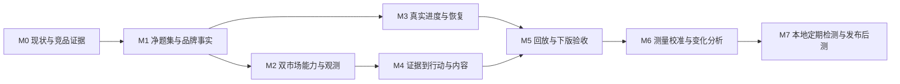

# OpenGEO 版本里程碑

状态：active（规划；数据分析与报告增量已实施，其他能力按各项状态）。最后复核：2026-11-09。

## 最新执行排序（用户 2026-11-08 调整）

当前先做数据分析看板和导出报告，策略、内容生产与其余建议延后。实施证据见[数据分析任务](../OPENGEO-20261108-ANALYTICS-REPORT/Report.md)。分析结果共用、覆盖/分组/信源和 HTML/Markdown 已落地；M1 题型与别名、净 v5 以及完整 M5 回放验收仍未完成，不整组勾选。

当前依赖顺序为 **M1 数据质量 → M2 覆盖核对 → M5 分析交付**；M3 只做支持分析的必要状态展示，M4 内容主线后置。下方原始依赖图作为完整业务链示意，不覆盖本段最新优先级。

2026-11-09 增量：报告正文与证据分层、确定性诊断和制作单、行动类别/优先级/待办/历史已在 0.4.0 落地；事实审核、官网审计、实际发布与后测仍未完成。

## 目标与版本判断

当前 0.4.0 已交付诊断报告与行动中心增量，见[验收](../OPENGEO-20261109-REPORT-ACTIONS/Report.md)。以下**可信双市场诊断版**仍是完整业务目标，不能因界面与报告已升级而整体标完成。目标是在本地把「品牌资料 → 问题 → 国内外观测 → 诊断 → 一条内容动作 → 复测协议」接成可审查的交付。长期目标是同一条链路可重复运行、比较和积累，始终为个人本地工具。

这里的「0 → 0.5」是项目成熟度叙述，不是完成率：已有本地引擎、证据、混合采样、回放、来源入库与人工确认；净松灵基线、策略语义验收和发布后测尚未完成。当前可以面试展示工程探索，不能称为已经验证增长的 GEO 产品。

**面试前最小交付（按最新指令）**：完成 M1 的数据质量门禁，做 M2 的小样本验收，再按 M5 完成数据分析与导出；M4 的内容链后置。M3 的完整界面、新网页 adapter、M6/M7 均不阻塞这次展示。若采样入口失败，交付真实失败和证据，缩小结论范围，不制造双市场成功样本。

候选执行顺序与依赖：

这是建议实施顺序，不新增必须使用的框架或云服务。每个 milestone 有独立产物与退出条件。

## M0：保留真实现状与困难（已完成本阶段）

- [x] 审计原松灵报告，说明标题污染、分母与题型问题；不删除旧证据。见[架构与面试评估](../OPENGEO-20261108-ARCHITECTURE-INTERVIEW/Report.md)和[V5 事故](../OPENGEO-20261108-V5-QUESTION-VALIDATION/Report.md)。污染 run 的产品内隔离仍在 M1。
- [x] 记录人工 → Playwriter 尝试 → Kimi + API 的探索；用户回忆和有日志的事实分级，不编提效数字。见同一[困难记录](../OPENGEO-20261108-ARCHITECTURE-INTERVIEW/Report.md#困难与取舍记录)。
- [x] 品牌来源最小入口已有：官网、文本、文字 PDF，页级来源/哈希、待确认事实与审核。已有测试证据见[交付记录](../OPENGEO-20261108-ARCHITECTURE-INTERVIEW/Report.md#验证)。不是 OCR、自动事实核实或完整品牌约束引擎。
- [x] Klepsy 与 Topify 本轮 UI/JS/NET 研究、REA 静态分析、未知项和对标完成。见[双市场对比](../../references/competitors/COMPARISON.md#2026-11-08-国内外商业产品实测)。

## M1：问题、事实与指标先可信（P0，面试先做）

承接 [V5 详细任务](../OPENGEO-20261108-V5-QUESTION-VALIDATION/Todo.md)。题目标题剔除代码已有，不能因此把全部数据质量任务打勾。

- [ ] 将污染 run 在元数据、列表、报告中标为 QA / 不可作正式基线；保留其原始证据，默认从正式比较中隔离。
- [ ] 冻结 10 条净题原文、版本、主题和题型：natural / candidate_comparison / branded_fact / evidence；Q8 含给定候选，单列比较题。
- [ ] 用已有入口导入用户实际提供的公司资料（当前未提供/未入库不算完成），审核页级事实和松灵/AgileX 等品牌别名；产品别名的归属需来源确认，不把产品名自动当品牌名。
- [ ] 品牌约束在 Project 中显式记录：受众、语言、允许的主张、禁用的夸大表述、产品/型号/单位/适用条件。来源只证明原文存在；确认事实与风格约束分别保存、版本化。该约束模型当前未实现。
- [ ] 将工作台首次出现顺序与枚举推荐名次分别命名；只有排序型题能算推荐 Top1/Top3，先冻结规则，避免悄悄改变历史指标。

**退出条件**：计划预览没有分组标题；每题类型和别名可检查；运行快照锁定版本；同一有效分母能回到逐条回答；缺事实或低覆盖时报告标探索性，禁止输出强结论。统计规则的正式变更同步[案例交付](../案例交付.md)，来源行为同步[采集](../采集.md)。

## M2：国内外覆盖可核对（P0，先小样本）

双市场是「有真实入口和明确边界」，不是要求所有平台均已支持网页。引擎归类、题目语言、地区元数据、采样通道、搜索设置分别保留。

| 入口 | 当前工程状态 | 下版验收 |
| --- | --- | --- |
| ChatGPT / Gemini 监测 | 独立 CloroMonitor 已接入，官方 SDK 合约与离线测试通过；真实批次另验 | API 传输、remote-monitor 协议、模型 UNKNOWN、保留来源与失败 |
| 本机 ChatGPT 网页 | 保留 Xue + Kimi 链路；当前 bridge_unreachable | probe/check 后才采样，不能代替 Cloro 远程监测身份 |
| DeepSeek / 千问 / 豆包 Seed API | 已有 OpenRouter 固定模型 API 路线；记录浏览器优先策略 | 至少一条真实国内模型有效回答；不等价于各自网页产品或联网搜索 |
| 国内网页（豆包或 DeepSeek 等） | 正式 adapter 未实现；历史手工样本另计 | 下版扩展候选，只选一个验证，不一次承诺全平台 |
| Claude 网页、Google AI Overview 等 | 当前正式链路未实现/不纳入 | 显示未实现，不当作失败回答或 0% |

- [ ] 平台卡显示「网页/API、已实现/未实现、配置/会话待验收、实际模型」，运行前展示问题数 × 已选入口与有效性规则。
- [ ] 做 2–3 条冻结问题的演示小面板，至少覆盖一个国内模型入口和一个海外入口；每格要么有效证据，要么明确失败。真实 Xue 网页失败则只保留失败；API 补测的真实身份单列。小面板不是 10 题正式 v5 的替代品。
- [ ] 原始问题直接发给观测入口；内部品牌 PDF、策略稿和确认事实不得追加进自然发现题的采样上下文。
- [ ] 汇总按通道、平台、题型分层；展示计划、有效、失败、未执行、覆盖。fallback 与 retry 只增加 attempt，同一 unit 最多采纳一条，通道变化不隐去。

**退出条件**：国内外各有可追溯有效观测才称双市场实测成功；未达到就交付覆盖缺口。不把本题集的结果写成市场份额或真实用户偏好。

## M3：长任务的真实进度与可恢复性（P1）

借鉴 Topify 阶段、Klepsy 事件，不复制无法证明的百分比。

- [ ] 阶段显示「资料校验 → 冻结计划 → 采样 → 指标 → 策略/草稿 → 导出」；每阶段有状态、开始/结束和最后更新时间。
- [ ] 采样计数 `processedUnits / plannedUnits`，另列 valid / failed / skipped / pending；processed 代表终态，不是成功。例：20/60 已处理，12 有效，8 失败，不把 33% 写成有效覆盖。
- [ ] 模型分析用当前步骤和耗时，不靠计时器填 95%；预计时间仅在有历史依据时给范围与来源。
- [ ] 沿用本地 run 查询先做轮询；事件需落盘/序号后再考虑 SSE。页面刷新只读原任务，不创建重复 run；从断开到恢复不重新提交问题。
- [ ] 中断、用户操作、超时和提交状态不明可见；已经送到平台的请求可能仍在生成，中断不谎称撤回；页面恢复不自动重发。

**退出条件**：断开页面再打开能看到同一 run、真实计数和终态；取消/失败用例不重复计数；两套 UI 表达一致。验证使用本地 fixture，真实采样另验，避免自动测试消耗账号配额。

## M4：策略和内容从证据推导（P0 内容主线，自动化部分 P1）

- [ ] Finding 合同包含 questionId、sampleId、逐字引文及定位、观察通道、数据覆盖、结论与不确定性；至少一条由人对原文核验。ID 存在与语义支持分开验证。
- [ ] Action 合同包含 findingId、目标受众/意图、真实目标 URL（未核验则标候选）、修改前后、所需 claimId、品牌约束、预期观察、复测问题/协议、状态。没有现行页面证据不诊断“标题有问题”。
- [ ] 生成路径替换「每条回答只取前 1200 字」的粗摘要：按问题引用相关原文片段并保留上下文入口；缺支持时请求资料或输出待核验，不填空泛建议。
- [ ] 做一条松灵英文 FAQ/选型内容链：一个真实问题、一条发现、已确认型号/参数、引用页码、内容正文与审核记录；正文应回答受众问题，不能重复策略描述。
- [ ] 数字冲突只在同实体、属性、单位、配置/条件、时间对齐后判定；其余是待核对数字。品牌硬约束违规阻止草稿进入 ready，不能把模型自评分当事实审核。
- [ ] 本地动作状态 suggested → todo → draft → reviewed / skipped；内容完成、人工发布、可访问、后测分别记录。界面不把 done 等同效果成功。

**退出条件**：审核者可逐句追溯关键主张；至少一个支持案例与一个不支持/型号冲突反例通过人工校准；没有事实支撑的内容被阻止或明确留空。面试前可人工完成这条链路，但必须说明人工策划比例；自动生成质量未验收就不宣传自动化完成。

## M5：回放与可交付报告（下版验收）

- [ ] 新净 v5 正式运行严格包含 10 题与冻结入口；小演示面板单独命名，不能混入 v5。运行失败照实留存，不强凑完整性。
- [ ] 客户报告给出范围、时间、有效/计划、逐平台覆盖、品牌结果、2–3 条有证据的发现（不足就少写）、行动和未知；原文与协议放证据附录。缺搜索量写 UNKNOWN，不使用没有来源的 CVR、volume 或 GEO 总分。
- [x] 报告导出与工作台使用同一 read model / metricVersion（[实现记录](../OPENGEO-20261108-ANALYTICS-REPORT/Report.md)）；下载到本地后可以定位原文，分享版移除账号、认证信息与私人本地绝对路径。保留脱敏 evidenceId/相对定位。
- [ ] 同一 evidence + protocol + metricVersion 离线重算同一结果；品牌别名或算法变更产生重算版本，不改写旧 run。
- [ ] 本地构建/单测通过；界面改动加浏览器测试；采集器改动加 probe/check。验证失败不得标完成，不把这轮纯文档检查当功能测试。

**退出条件**：可以用 5–8 分钟演示「资料 → 问题 → 原文 → 发现 → 稿件 → 复测计划」，并解释一次真实失败。没有真实发布和后测时，报告结尾写明效果未知。

## M6：把 GEO 测量做成可靠的数据工作（长期候选，未实现）

- [ ] 建人工标注集：提及/归属/推荐/引用支持/冲突，按模型/语言分层抽查，报告误报漏报和标注分歧；小样本不声称通用准确率。
- [ ] 冻结题目 × 通道 × 协议，多时间窗重复；按题配对比较，同时展示覆盖和缺失变化。模型随机性、同题相关性、搜索与会话变化单独记录，不把全部回答当独立随机样本。
- [ ] 域名/URL 归一化与引用分析分开保存 raw URL 和规范 URL；链接、检索结果、正文采用、支持事实各有明确口径，公式与分母可回放。
- [ ] 本地质量看板：协议/模型漂移、页面 adapter 漂移、失败分类、采样耗时；成本记实际可取得的 token/费用，浏览器记耗时与失败，未知不猜人民币报价。运行前本地预算上限与停止条件。
- [ ] 只有出现实际 JSON 写冲突、回放性能或查询瓶颈，再评估 SQLite 事务/索引迁移；先兼容导出、备份和恢复，不为面试引入数据平台。

**价值证明**：给相同证据重算、给变化指出协议原因、给缺失指出偏差；不把运营建议包装成统计因果结论。

## M7：个人本地持续检测与效果复查（长期候选，未实现）

- [ ] 增加本地计划任务、单实例锁、用户可停；设备睡眠/离线记 missed，不补造采样时间，不悄悄补发整批问题。
- [ ] 手工发布登记链接、内容版本、时间、修改点和责任人；检查可访问，索引与 AI 引用分别检查，不把已发布当已收录。
- [ ] 按固定协议后测；比较前后覆盖、原文和变化，条件允许时设未改页面/题组参照。仅有前后变化也不直接声称因果提升。
- [ ] 记录下一轮动作与证据，内容生成保持人工审核；默认本地、可导出、可清除，不做云端账号池、计费、团队权限。

## 工程落地方式：沿用本地单体，先补合同

当前服务与模块见[架构评估](../OPENGEO-20261108-ARCHITECTURE-INTERVIEW/Report.md#实际架构)。下表均为候选增量，不表示已开发。

| 边界 | 沿用位置 | 增量责任 |
| --- | --- | --- |
| 品牌资料与约束 | brand-sources / Project / claims | 页码、原文、确认状态、实体条件与版本；事实和风格约束分开 |
| 采样计划与执行 | engine / measurementUnits / attempts / browser | 冻结问题与协议、能力矩阵、终态计数、选择唯一回答 |
| 分析 | brand-metrics / geo-rates / analysis | 名次语义分开、共享分母、metricVersion 与 evidence links |
| 策略与内容 | skills / international / Campaign | Finding → Action → Draft 合同，支持关系与人工审核；共享事实模型，不强合并两条运行路径 |
| 展示与导出 | server / public 两套页面 / render | 共用只读结果投影，统一指标与失败显示，逐步减少重复视图逻辑 |
| 数据与恢复 | 本地 Store / 快照 / evidence 目录 | 保留原始观测、版本化派生结果；先 run 状态持久化，再增事件游标；不声称现有 JSON 是跨进程事件数据库 |

建议快照最小集合：questionSetVersion、题型、source/claim/alias/constraintVersion、protocolId、metricVersion、language、region（未知允许）、requested/actual provider+model、channel、搜索设置与可见搜索证据、时间窗、unitId、attemptId、selectedSampleId、evidence hash。**这些字段部分已有，完整统一快照未实现。**

观测链与建议链隔离：采样看冻结题目；策略读取确认事实与已落盘观测；策略稿不回灌为“自然发现”的证据。派生指标可重算，原始回答不可静默替换。缺值保留 null，同时用状态区分失败、未执行和不适用。

## 面试讲述与真实性边界

可以讲：从手动试问到浏览器自动化，再到指定登录态的 Kimi + API 混合；对失败、重复尝试、输入污染和来源约束做了工程处理；对标后主动压缩下一版范围。Playwriter 的权限困难来自个人经历，不说成行业普遍限制；不能把 Playwriter 与 Playwright 混称。

还不能讲：已覆盖国内外所有真实网页、自动策略已达交付标准、已减少采样成本某百分比、已提高品牌推荐/流量/收入。没有计时、成本对照或发布后测就没有这些结果。

每完成一个 milestone，把**问题 → 证据级别 → 方案及取舍 → 真实验证 → 遗留**追加到所属任务 Report；只在本页勾选并链接，不另建重复面试故事库。M0 不是成功包装，M1–M7 不是已完成工作。
