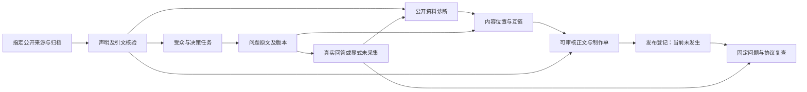

# 案例交付

更新：2026-11-08。当前主案例是[松灵机器人](../案例/松灵机器人/00-案例说明.md)。本仓库仍是本地、单用户工作台。这一轮是外部研究，没有公司后台、硬件或发布权限。

Campaign 把受众、问题、内容位置和复查写成明确合约。现有 Project、AgentRun 和采集模块继续用，不另做账号系统，也不为单个案例重做工作台。



语义判断由执行任务的 Agent 读原文后写入策划。运行器做确定性校验和生成。`editorial-input` 是策划输入，`deterministic` 是规则执行。当前没有自动派生多个独立 Agent，没有额外模型调用，也没有自动发布或持续采样。

## 代码

| 层 | 位置 | 责任 |
| --- | --- | --- |
| 合约 | `code/src/citekeel/campaign/model.ts` | 来源、声明、受众、问题、内容、尝试、协议、发布记录、执行结果 |
| 证据 | `campaign/evidence.ts` | 指定 URL 串行读取、正文提取、不可变快照、哈希和本地路径 |
| 运行与比较 | `campaign/run.ts` | 引文核验、失败排除、同任务去重、逐题逐平台逐协议统计、两轮可比性 |
| 采样导入 | `campaign/import-attempt.ts` | 核对案例内四件套、Xue 身份、问题原文、协议和可见链接 |
| 交付 | `campaign/render.ts` | 执行摘要、诊断、受众问题、布局、正文、基线、回答明细 |
| CLI | `code/scripts/campaign.ts` | collect / run / install / compare / import-attempt |
| 回归 | `code/test/campaign.test.ts` | 离线 fixture。测试通过不证明真实 GEO 效果 |

`01-案例策划.json` 是可审查的分析输入。`02-来源归档.json` 保存读取方法、覆盖、失败和 SHA-256。`03-采样记录.json` 只接受实际尝试。历史松灵首轮曾包含 ChatGPT、Perplexity、Gemini、DeepSeek 的网页记录；当前 vNext 默认海外入口收敛为 ChatGPT 与 Gemini，Perplexity 历史证据保留但不再进入默认诊断矩阵。千问有拒绝回答，豆包提交后提示访问频繁，失败不进分母。

映射到旧 Project 时，公开声明保持 `unconfirmed`。引文对上了，也不等于产品事实已经核实。

| 节点 | 交接产物 | 边界 |
| --- | --- | --- |
| 来源与声明 | 带来源、型号范围和短引文的声明 | 引文存在不等于产品实测 |
| 受众 | 决策任务、关切、依据、验证方式 | 官网目标受众和真实客户痛点分开 |
| 问题 | 阶段、语言、是否点名、原文与版本 | 候选问题不写成真实搜索需求 |
| 回答诊断 | 出现与原句、有效分母、失败原因 | 没有 Xue 连接就是未采集 |
| 布局 | 页面或稿件、位置、互链、制作单 | 建议位置尚未发布 |
| 内容 | 独立正文、来源链接、审核缺项 | 不编造成功案例 |
| 复查 | 当前基线、观察差值 | 没有后台数据，差值不是因果 |

Skill 入口是 [`opengeo`](../code/skills/opengeo/SKILL.md)、[`audience-research`](../code/skills/audience-research/SKILL.md) 和 [`content-layout`](../code/skills/content-layout/SKILL.md)。

## 命令

在 `code/` 执行：

```bash
npm run campaign -- run "../案例/松灵机器人/第1轮"
npm run campaign -- install "../案例/松灵机器人/第1轮"
npm run campaign -- compare "<前轮目录>" "<后轮目录>"
npm run campaign -- import-attempt "../案例/松灵机器人/第1轮" --id <新采样ID> --job <同任务ID> --question Q01 --platform chatgpt --evidence evidence/incoming/Q01-chatgpt
```

- `run`：只读归档并重算，覆盖派生报告，保留来源和采样输入。没有新的网络或模型调用。
- `install`：重算后导入本地工作台。同一项目已存在时，不覆盖人工确认、历史样本和设置。
- `collect`：按明确 URL 采集公开资料，不带登录态。已有来源归档时拒绝覆盖。
- `compare`：只比较同一案例的递增轮次。品牌口径、问题全文与版本、平台和完整协议必须一致。未知条件不算差值。后轮生成 `13-两轮比较.md`。可比差值仍然不是运营提升。
- `import-attempt`：不联网，不提交问题。采集器先把四件套放到案例内临时目录；导入时核对 metadata，去掉问题原文造成的假品牌命中。同一 jobId 的重试不增加分母。

搜索工具能拿到正文片段、HTTP 却失败时，可以保存工具返回的原文，并写明 `native-web-excerpt` 和 `excerpt`，同时保留原来的 HTTP 失败。松灵首轮的 5 项官网来源是这种情况；官方 GitHub 的 3 项是 HTTP 文本。

## 下一轮：问题集诊断口径（待实现）

一个品牌用自己的固定题集。当前 vNext 首选面板为 Cloro 的 ChatGPT/Gemini 监测 API；国内 DeepSeek、千问、豆包直接使用 OpenRouter API，浏览器采样后置。各入口的具体路线见[采集](采集.md)。计划粒度是「题目 × 入口 × 本轮时间窗」；同一单元最多计一条有效回答。统计先汇总所有计划入口的有效回答，再给出按通道、平台、模型、语言和是否点名的明细。总表直接汇总分子与分母，不取平台百分比的平均数。API 补测用实际通道，和对应网页失败都可查看。

| 指标 | 下一轮口径 |
| --- | --- |
| 问题集出现率 | 至少一个入口提到品牌的题数 / 可判定题数。一题命中多个入口仍只算一题；无命中且有计划入口缺失时为未知；所有计划入口都有效、仍无命中才记未出现。 |
| 提及率 | 提到品牌或已确认别名的有效回答数 / 所有入口的有效回答数。一题在多个入口都被提及，可分别贡献命中。问题文本、单纯复述题目和链接里的字符串不算正文命中。 |
| Top1 率 | 品牌出现在明确推荐顺序第 1 位的回答数 / 所有入口中有可判定推荐顺序的有效回答数。 |
| Top3 率 | 品牌出现在明确推荐顺序前 3 位的回答数 / 同一批有可判定推荐顺序的有效回答数。 |

排名基于回答中的全部可比较候选，包含未跟踪的竞品，不因只跟踪目标品牌而抬高名次。能明确判定的排名名单没有目标品牌，就记未入榜；普通编号、核验步骤、参数表和无明确顺序的分组不算排名。题集应预先区分排序题和事实题。提及类指标同屏给未点名明细，避免点名题掩盖自然发现。保留每个分子的原句、候选位置和回答 ID。引用继续作为诊断证据展示。

例：4 题 × 7 入口 = 28 个计划单元，24 条有效；6 条回答提及品牌，分布在 2 题，另有 1 题七个入口都有效但未命中，剩下 1 题未知。报告写出现率 `2/3（1 题未知）`、提及率 `6/24`、采集覆盖 `24/28`。若所有入口合计有 12 条可判定推荐次序的回答，品牌在其中 2 条排第 1、4 条进前三，Top1 `2/12`、Top3 `4/12`。没有可判定顺序则显示无分母。

先打通一条网页、一条直接 API、一个网页失败后由 API 补测的单元，验收同单元只计一次、失败不进分母、补测明细可追溯、离线重放得到相同结果。再按实际可用性扩展入口，不把“七入口”当成当前必须完成的目标；冻结模型与检索配置后再跑松灵新基线。做趋势时只比较同题版本、同入口和同协议的单元；网页改 API、模型或检索设置改动时在图表上标为协议变化。缺失变化可能改变当期总表，不能单凭总表涨跌认定品牌效果。

## 首轮现有实现的口径

当前代码按通道、平台、模型分开出率，没有实现上一节的面板总表。以下保留旧口径用于回放，API 回答仍标 `api`。

| 率 | 公式 | 分母 |
| --- | --- | --- |
| 提及率 | 合格回答里，品牌名或已确认别名至少出现一次的条数 / 合格回答条数 | 该平台、该模型、该通道上的合格回答 |
| 出现率 | 与提及率同一公式。代码里没有第二套出现率 | 同上 |
| Top1 率 | 品牌是枚举名单第 1 项的条数 / 存在枚举名次的合格回答条数 | 没有编号列表或明确排序的回答为 null，不进入分母，也不记成否 |
| Top3 率 | 品牌名次为 1、2 或 3 的条数 / 存在枚举名次的合格回答条数 | 同上。名次大于 3，或名单里没有该品牌，记为否 |

合格回答不包括失败调用、空回答、登录墙、验证页、限流和拒绝回答。`null` 不是 0%。枚举名次只认从 1 连续编号的列表、从 1 连续的序数行、表头写明 Priority / Rank / 名次 / 排名且序号连续的表格，或“推荐顺序 / ranking / in order”后面的并列名单；没有名次表头的表格和代码围栏里的编号不算。实现是 `code/src/citekeel/geo-rates.ts`，案例报告写在监测方案里。

`code/src/citekeel/brand-metrics.ts` 仍按已跟踪品牌的首次出现位置计算另一套 Top1/Top3，分母是全部合格回答。那不是这里的枚举名次，案例报告不使用它。

豆包和千问的网页采集暂停。未采集保持未采集，不写成 0%。OpenRouter 试跑不写回第 1 轮的 `03-采样记录.json`，也不重采已经导入的网页样本。

## 松灵首轮

### 2026-11-08 v5 QA run，不作为基线

Run `20952027-9bb5-4844-b224-ba55f396c32d` 误把「非点名题」和「点名题」两个分组标签当成问题，原始计划 96 单元、有效 52 条。剔除 16 个无效单元和 14 条无效回答后，真实 v5 问题应为 80 个计划单元、38 条有效回答。该 run 保留为工程证据，顶部汇总率和由标签题生成的策略任务不得进入案例基线。防重入修复与后续待办见 [`OPENGEO-20261108-V5-QUESTION-VALIDATION`](OPENGEO-20261108-V5-QUESTION-VALIDATION/Report.md)。

8 个公开来源、16 项有原文定位的来源陈述、3 组受众、12 个中英文候选问题、4 个内容交付：未点名科研选型指南、PiPER 集成 FAQ、教育选型指南、LIMO PRO 参数标签核验提案。

这一轮只评价公开材料和内容机会。LIMO PRO 文本里的 Payload / weight 标签疑点是待核验项。产品页面已有 FAQ 和技术入口，内容建议不能写成“官网没有 FAQ”。

当前是：`AI 基线=ChatGPT 3 条、Perplexity 2 条、Gemini 2 条、DeepSeek 2 条已进入分母；千问 Q11 是拒绝回答，千问 Q12 被登录框拦住，豆包提交后访问频繁`，`发布=未记录`，`效果=未知`。

| 阶段 | 验收 | 状态 |
| --- | --- | --- |
| 交付架构 | 一个受众问题能回到材料、制作单、正文和复查任务；可离线复跑 | 已实现 |
| 松灵内容 | 稿件有来源、适用边界和审核缺项 | 已有首轮稿，未经公司审核 |
| 工作台 | 用既有 Project 展示资料和候选 | CLI 已实现 |
| 真实基线 | 核对 Xue 后执行 12 条第一批：国际平台英文未点名 / 点名各一，国内平台中文未点名 / 点名各一 | Xue 已核验。ChatGPT 的 Q01、Q03、Q07，Perplexity 的 Q01、Q03，Gemini 的 Q01、Q03，DeepSeek 的 Q11、Q12 已归档。千问 Q11 是拒绝回答。千问 Q12 弹出登录框。豆包提交后访问频繁 |
| 回答诊断 | 用真实原句补品牌印象、竞品叙事、引用和参数风险 | 已写入 F05–F13。规格、价格和型号比较仍是回答说法 |
| 复查 | 相同协议和问题版本的比较 | 比较器已实现，真实后测未做 |
| 运营效果 | 发布回执和授权后的后台数据 | 当前没有权限，不写效果 |

## 工作台调研报告导出

2026-11-08：`/api/runs/:id/report` 输出数据调研 Markdown，`/report-html` 输出可离线打开和打印的 HTML。两者沿用 `/analytics` 的 model/channel/days 筛选与运行快照，包含范围、有效/计划、分组品牌、逐题覆盖、观测日、域名与 URL 信源、失败和尝试、公式/版本、原文附录；没有新增观测或模型分析。默认不附工作流策略/内容草稿，原工作台功能和 JSON 证据导出保留。

HTML 不执行回答中嵌入的脚本、远程图片、表单或非 HTTP(S) 链接；认证 URL 参数沿用脱敏规则。正文为已有原文，外发仍需用户确认可分享范围。此次不是 Campaign 固定协议的正式松灵交付，不补造发布/后测结果。报告导出实现不意味着污染旧 run 成为合格基线，净 v5 仍待完成。
