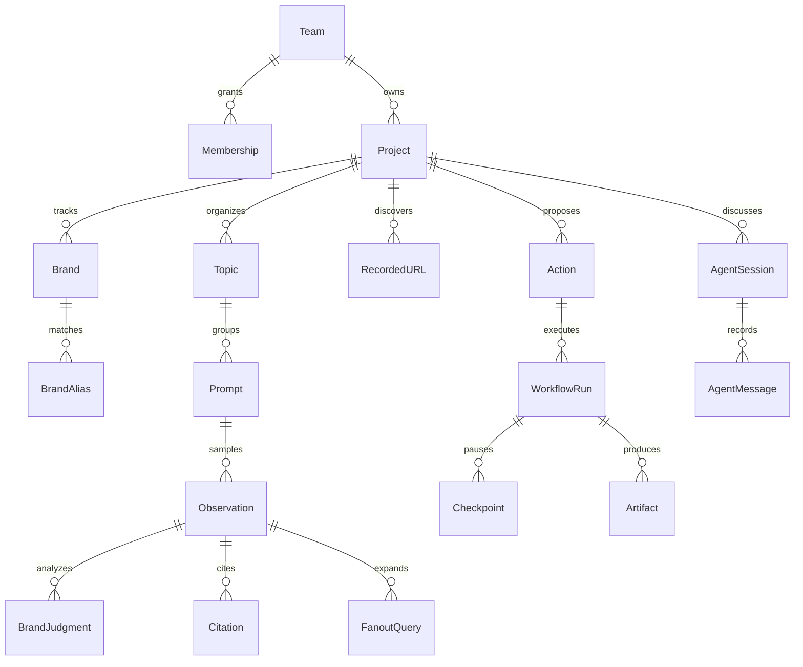

# 03 接口、响应与数据模型

## 1. 三个不同接口边界

1. **浏览器内部接口（NET / JS）**：Next 同源 `/api/v1/*`、`/api/v2/*`，以及 `/api/stripe/*`、`/api/heatmap*`。有些查询用 POST，不能按方法名直接判断是创建。
2. **公开集成 API（DOC）**：`/api/public/v1/projects/{project_id}/...`，团队管理员颁发的 API key，作用域覆盖其团队项目。
3. **下游服务（UNKNOWN）**：内部 BFF 如何转发到采样、内容、搜索数据、存储服务，现有静态包不能完整恢复。

公开 API 的 action execute 是异步任务与 webhook 设计；浏览器内部 action execute 则由客户端读取 SSE。两者不可直接互换。

## 2. 内部接口分组

下列路径为 JS 还原或 NET 直接观察；动态参数已规范化。完整记录见 [静态候选](evidence/static-client-contracts.json) 和 [实际网络](evidence/network-operations.json)。

| 能力 | 接口族 | 可确认行为 |
| --- | --- | --- |
| 项目 | `/api/v2/projects`、`/{id}` | GET / POST / PUT / DELETE 客户端路径；GET 已观察 |
| 默认品牌 / 别名 / 表格设置 | `/projects/{id}/settings/{default-brands,aliases,table-settings}` | 默认筛选、品牌匹配配置、列设置 |
| 初始化 | `/api/v1/bootstrap/{initialize,prompt,complete}` | JS 中的三步客户端入口；未重建新项目执行 |
| 概览 | `POST /api/v1/overview/visibility`；`POST /api/v2/overview/analysis/prompt` | NET 200；趋势与问题聚合分离 |
| 问题 | `/api/v2/prompt/{id}/{analytics,chats,domains,urls}` | 问题分析与证据下钻 |
| 问题生命周期 | `/prompts/{id}/convert-to-active`、`convert-to-inactive`；`/prompts/suggested` | 激活 / 停用、建议生成与失败清理 |
| 主题 | `/api/v2/topics`；`/prompts/batch/assign-topic` | 主题查询、批量归组 |
| 网址池 | `/api/v2/recording`、`/recording/list`；`/prompts/url-recommendations` | 网址 CRUD、生成与轮询；list 使用 POST |
| 信源 | `/api/v2/sources/{list,table,detail,chats}`；detail summary / urls；top-prompts / provider-breakdown | 域名与 URL、引用原文、模型分布 |
| 竞品 | `/api/v2/competitors`、events；详情 summary / trend / questions / answers | 活跃 / 待审、回补、逐品牌证据 |
| Fanouts | `/api/v2/prompts/fanouts`、insights、prompts；output fanouts | 子查询与原问题 / 回答关联 |
| Actions | `/api/v2/actions`、recommend、tasks、enrich、batch、discard-edit | 建议、异步任务、状态、舍弃编辑 |
| 工作流 | `/api/v2/actions/{id}/execute`、`execute/resume` | POST + SSE；workflowId 与决策恢复 |
| Agent | `/api/v2/agent/chat`、sessions、action-items、settings、project-data | 消息流、会话、计划、配置、持久上下文 |
| 团队与 key | `/api/v2/teams/*`、members、api-keys | 成员角色、项目授权、key 生命周期 |
| 计费 | membership overview、Stripe portal / checkout / update-subscription | 额度与订阅；未执行付费操作 |

205 条候选记录并非 205 个唯一、可调用 API。`unresolved` method、`{param}` 与 `{value}` 保留了静态还原的不确定性；v1 代码的存在不证明所有旧接口仍被当前页面使用。

## 3. 响应封装并不统一

本次实际观察：多数 v2 为 `{code, message, data}`；Action 列表样本为 `{data: []}`。公开文档另有 `{success, data}`。客户端适配应按 endpoint 解码，不能全局写死一个 envelope。

[response-shapes.json](evidence/response-shapes.json) 只记录字段名与类型，不含值。空数组写为 `unobserved`，表示不能知道 item 结构，不等于不存在该功能。

## 4. 数据实体关系（DESIGN：对证据的工程化解释）

这是建议实体划分，不是 Topify 的数据库 DDL。真实字段依据按下表区分。

| 实体 | 已观察或静态可确认的字段 | 备注 |
| --- | --- | --- |
| Project | id、name、brandName、websiteUrl、ownerId、status、lifecycleStatus、location、createdAt、updatedAt、bootstrapData | NET camelCase |
| Competitor | competitor_id、project_id、name、website、icon_urls、state、is_our_own_brand、metrics | NET；metrics 有 visibility / sentiment / position / sov / deltas |
| Source aggregate | analysis_status、stats、chart_data、category_breakdown、domain_table、url_table、opportunities | NET；不等同原始 citation |
| Source domain item | rank、domain、domain_type、citation_count、citation_share_pct、avg_citations、used_percentage、mentioned、brands_appeared | NET |
| Prompt | content、prompt_type、topic_id、country、intent、指标 | UI / DOC / JS；官方字段存在冲突，见 05 |
| Observation / output | prompt、provider、原文、检测品牌、引用；按 output 查询 Fanouts | DOC / JS；未恢复服务端内部所有字段 |
| Fanout page | items、distinct_query_count、total_occurrences、total_items、page、page_size、total_pages | NET；本样本 items 为空 |
| Action | category、status、targets、execution、depends_on、priority、effort | DOC / JS；当前列表为空，不能宣称抓到真实 Action 完整对象 |
| Checkpoint | workflowId、checkpoint、title、description、content、metadata、options | JS 流事件 |
| Membership overview | plan、trial、scheduled change、limits、usage、credit_balance、role、allowed_project_ids | NET 字段形状；不保留账号值 |

## 5. 必须保留的关联

- Prompt 的版本、地区和采样条件 → Observation。
- Observation → 被检测的品牌、首次提及位置、情绪判定、引用、子查询。
- Source domain / URL → 它引用的回答与问题。
- Action → 产生建议的问题、信源、品牌差距与目标。
- WorkflowRun → Checkpoint → decision / revision → Artifact。
- Session 与工作流有相互引用，但会话消息不能取代工作流状态。

## 6. 公开接口边界

官方文档中的 [Prompts](https://docs.topify.ai/api-reference/prompts)、[Sources](https://docs.topify.ai/api-reference/sources)、[Overview](https://docs.topify.ai/api-reference/overview)、[Visibility](https://docs.topify.ai/api-reference/visibility) 描述了集成读写表面。部分 endpoint 的分页、日期参数和封装各不相同；公开 key 不能放进浏览器。

本轮没有创建 key、探测未授权项目或越过现有登录权限。接口清单是重建本地产品的参考，不是要求 OpenGEO 依赖这些私有接口。
