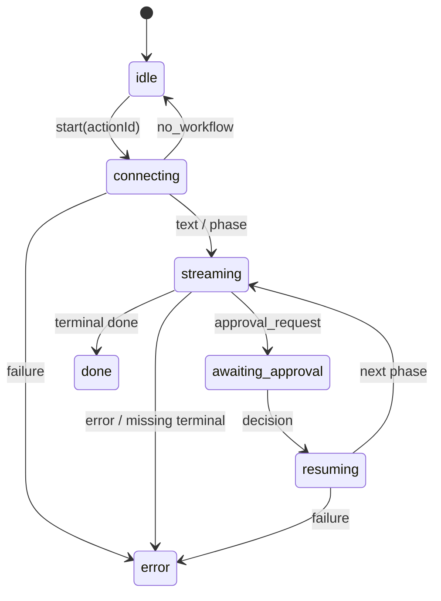

# 04 Agent、双流协议与执行状态机

## 1. 已确认的 Agent 组成

UI 有聊天、历史、项目知识、指令、关键词、竞品、GSC、CMS、内容生成配置与行动计划。JS 有 sessions / messages、project-data、settings、action-items、chat，以及独立 Action workflow。

因此可将系统拆成：项目上下文、能力选择、会话、步骤执行、审批、产物、集成。**这是一种架构还原，不证明其私有服务端采用某个 Agent 框架。** LangGraph / LangChain / 自研 runner 均未被证实，模型系统提示词也未取得。

## 2. 两套流协议

| 通道 | 证据 | 协议与职责 |
| --- | --- | --- |
| Agent chat | `page-fbcc3cd1317e130a.js` | useChat 风格客户端；`/api/v2/agent/chat`；`streamProtocol: data`；body 包含 projectId、会话 id 与消息 |
| Action execution | `1522-3dd05f2665a3638c.js` | `/api/v2/actions/{id}/execute` 与 `/execute/resume`；读响应流，逐行处理 `data:` 后的 JSON |
| 公开集成 | 官方 Actions / Webhooks 文档 | execute 202 + 回调通知与查询；与浏览器 SSE 契约不同 |

不能把所有东西统称 SSE，也不能把 API 的 202 / webhook 直接写成浏览器 useChat 的返回。

### Chat 的结构化事件（JS）

客户端除了文本，还解析 skill_result、action_items、proposed_actions、claude_code_prompts、approval_request，以及阶段信息。可识别字段包括：

- skill_result：skill、summary、formatted、data。
- proposed_actions：items、projectId、chatId、skill。
- approval_request：workflowId、checkpoint、title、description、content、metadata、options。

这些字段能指导 OpenGEO 的事件 envelope，但不代表本轮运行过所有 Skill。聊天 SDK 自带的 tool-call / reasoning 解析能力也不能直接当成 Topify 已启用的业务功能。

### Action SSE 的事件（JS）

| 事件 | 客户端行为 |
| --- | --- |
| text_delta | 累加 content，进入 streaming |
| phase | 更新 id / label / status / skill |
| status | 展示运行提示 |
| approval_request | 清空当前流式片段，保存审批，进入 awaiting_approval |
| error | 提取错误码与友好错误，终止读取 |
| no_workflow | 返回 idle |
| done | 完成；已经待审批或报错时不覆盖状态 |

流提前断开且没有终态时，客户端报错，而不是把截断内容当成功。AbortController 用于停止本地流；它不自动证明后端任务已经取消。

## 3. 浏览器工作流状态



这是客户端状态，不是 Action 的业务状态。Action 另有 suggested / accepted / in_progress / completed / ignored；UI 还聚合为 Todo / Done / Skipped。二者要分别存储。

## 4. 审批与恢复

JS 中出现的 checkpoint 包括 outline、draft、final_review、publish_confirm、configure_cms、research_review、thread_review、comment_review。具体组合依赖任务，不能强制所有任务都走一套顺序。

Resume 请求字段：workflowId、decision、editedContent、feedback、editedMetadata。审批界面支持预览、编辑与反馈；代码中可见 approve / edit / regenerate / skip 等决策。服务端必须验证 checkpoint 与 revision，不能只接受前端传来一个 approved=true。

模式有 manual 与 auto。UI 文案分别为 Review & Confirm 和 Skip Validations。**审批模式按钮是直接切换配置，不是只打开说明菜单**；本轮未修改该设置。OpenGEO 初版以已有明确确认门为基线，若以后引入 auto，需要给发布等副作用单独的授权约束。

## 5. 可恢复的工作流轮廓

### 新文章

```text
站点知识 / 关键词 / 主题准备
→ research_review（可能）
→ 生成 outline → 审批 / 编辑 / 再生成
→ 写正文 → 审批 / 编辑 / 修订
→ final / publish_confirm
→ configure_cms（缺配置时）
→ 发布或保留草稿 → 记录产物与链接
```

代码标签有 workflow-outline、workflow-regen-outline、workflow-write、workflow-revise、workflow-publish。显示的时间是界面估计，不是实测 SLA。

### Reddit

```text
搜索可回复帖子
→ thread_review（选择帖子、查看来源查询）
→ 生成回复
→ comment_review（筛选、编辑）
→ 后续任务状态 / 产物
```

不能因为存在论坛回复草稿就推断它已具备自动登录 Reddit 发布的能力。官方 [Actions](https://docs.topify.ai/api-reference/actions) 把 forum_engagement 描述为回复草稿；本轮未做对外发布验证。

### 研究与计划

UI 分类包括关键词、指定主题关键词、竞品关键词差距、SEO 审计、技术检查、内容差距、内容策略、流量、排名、GEO 报告等。它们是能力入口，不等于独立 Agent 进程。

## 6. 项目记忆与配置

观察到的持久化表面：

- settings：user_notes、approval mode、CMS / GSC / 内容服务配置等。
- project-data：site-profile、keywords、competitors。
- sessions / messages：聊天历史。
- action-items：计划与建议。
- artifacts / discarded edits：公开接口与客户端的产物和舍弃编辑表面。

可确认有持久上下文；未确认向量库、语义检索、长期记忆总结算法、Agent 自主学习。

## 7. 错误恢复

客户端区分 SITE_PROFILE_REQUIRED、KEYWORD_RESEARCH_REQUIRED、ARTICLE_INPUT_REQUIRED、AUTHENTICATION_REQUIRED、WORKFLOW_EXPIRED、CONTENT_SERVICE_UNAVAILABLE、SERVICE_UNAVAILABLE、NETWORK_ERROR 和 WORKFLOW_FAILED。

这些是有用的产品契约：输入缺失、会话失效、工作流过期、下游故障与网络问题应有不同恢复入口。原始服务错误不应直接泄露到页面；本轮概览曾出现包含供应商诊断的报错，这不是应照搬的展示方式。

## 8. 公开 webhook

官方 [Webhooks](https://docs.topify.ai/api-reference/webhooks) 定义 action.checkpoint / action.completed / action.failed，并区分只在创建时返回的签名 secret 与列表数据。OpenGEO 若提供 webhook，应把签名校验、事件去重与投递重试作为独立传输层；不要让 webhook 替代本地持久状态。

## 9. 验证边界

本轮确认了 UI、静态协议、事件解析和配置入口，没有提交生成任务、审批决策或 CMS 发布。部分页面自然触发了推荐任务，已记录 202；未据此宣称成功生成了文章。完整模型调用预算、服务端恢复存储和实际发布质量仍属 UNKNOWN。
